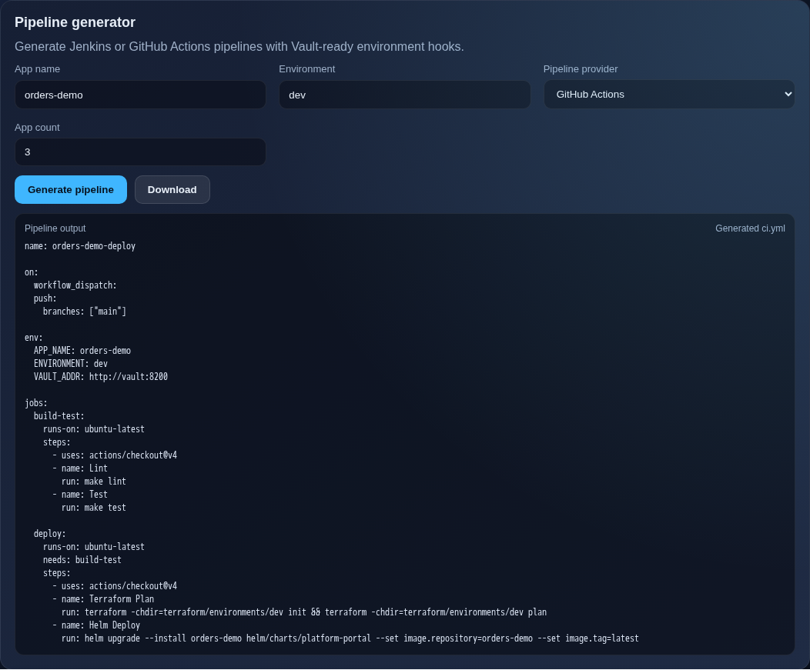
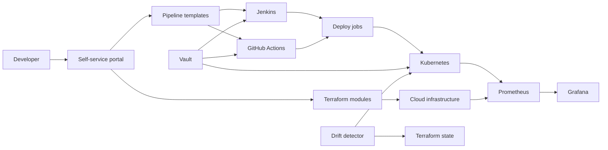
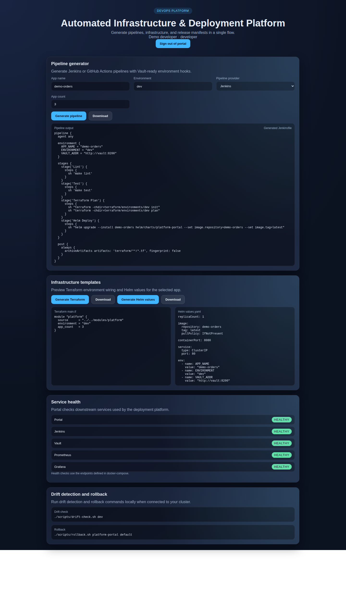

# Automated Infrastructure & Deployment Platform

## Developer self-service portal

Standardize how your team prepares applications and deployment configurations.

**What I can deliver:** A developer portal that generates pipeline and infrastructure templates, checks service health and applies role-based access.

**Skills demonstrated:** Portal UI, template generation, OIDC/RBAC, Jenkins, Terraform, Helm.

[Browse the feature screenshots](screenshots/README.md) · [Services and project enquiries](../README.md#discuss-a-project)



*Actual demonstration capture. Templates and local integrations are demonstrated; generating a template does not provision a cloud account.*

<details>
<summary>Technical documentation: features, architecture, setup and tests</summary>

## Demo
- Live: local demonstration; use the commands below.
- Screenshots:
  - `screenshots/20251228_1728_Automated Deployment Hub_simple_compose_01kdjs4gt6ecwvwzf7axpd3xy0.png`
  - `screenshots/20251228_1728_Automated Deployment Hub_simple_compose_01kdjs4gt7f1ztphzn9c0kwrpe.png`
  - `screenshots/20251228_1728_Automated Deployment Hub_simple_compose_01kdjs4gt8ej1bwxq5hnkrmjps.png`
  - `screenshots/20251228_1728_Automated Deployment Hub_simple_compose_01kdjs4gt9eg4rs8rzdwstz937.png`
- Local: http://localhost:8080 (after `make dev`)


## Why this exists
Teams lose days to manual infrastructure setup, one-off pipeline scripts, and inconsistent deployment patterns. This platform standardizes the workflow so new services can go from request to pipeline and infra templates in minutes, cutting onboarding time, reducing drift, and making audits easier.

## Features
- Self-service portal for infra and CI/CD template generation
- Terraform module catalog for reproducible infrastructure provisioning
- Jenkins and GitHub Actions pipeline templates per request
- Helm values generation for environment-specific app releases
- Vault-backed secret injection with short-lived tokens
- Prometheus and Grafana dashboards for platform health

## Architecture


Component flow: developers request infra and pipelines through the portal UI. The portal API renders templates from `portal/templates` and exposes `/api/metrics` for Prometheus. Terraform modules provision cloud resources, Helm charts deploy apps to Kubernetes, Vault brokers secrets, and Prometheus/Grafana provide visibility. Drift detection compares Terraform state and Kubernetes manifests to actual state and supports rollback. More detail in `docs/architecture.md`.

## Tech stack
- Backend: Node/Express for lightweight request handling and template rendering.
- Frontend: static portal UI served by the API for fast local demos.
- Infra: Terraform modules for reusable infrastructure definitions and drift checks.
- Delivery: Helm charts for Kubernetes deployments with environment overrides.
- CI: Jenkins and GitHub Actions to cover legacy and GitHub-native pipelines.
- Security: HashiCorp Vault for secrets brokering and short-lived tokens.
- Observability: Prometheus and Grafana for metrics and dashboards.
- Local dev: Docker Compose and Make to standardize startup.

## Quickstart (local)
Prereqs:
- Docker and Docker Compose
- Make
- Terraform, Helm, kubectl (only needed for infra/deploy steps)

Run:
```
make dev
```
Then open `http://localhost:8080` to generate pipelines and templates.

Optional config:
- `cp .env.example .env` and override service URLs, tokens, and log level.
- Structured logs are emitted to stdout; example in `docs/logging.md`.

Example usage: provision a Jenkins pipeline for a Node.js app
1) Open the portal and enter `orders-api`, environment `dev`, provider `jenkins`.
2) Click "Generate Pipeline" to download the Jenkinsfile template.
3) Click "Generate Terraform" and "Generate Helm" for infra and deploy values.
4) Commit templates to the service repo and run CI to provision and deploy.

Service URLs (local):
- Portal: http://localhost:8080
- Jenkins: http://localhost:8081
- Vault: http://localhost:8200
- Prometheus: http://localhost:9090
- Grafana: http://localhost:3000

## Tests
```
make test
```

## Security
Secrets: use `.env` (see `.env.example`). Vault handles runtime secret injection. Threat model basics live in `docs/threat-model.md`. Security policy is in `SECURITY.md`. Enable secret scanning in GitHub; Dependabot config lives in `.github/dependabot.yml`.

OIDC login and callback share a per-client limit of 60 requests per ten minutes.
Excess attempts return HTTP 429 with `Retry-After`. The counter is local to each
portal process; deployments with multiple instances need a shared limiter store.

## Notes / limitations
- Status: MVP prototype focused on template generation and local demos.
- Terraform modules are illustrative and do not target a specific cloud by default.
- CI pipelines focus on structure and integration points, not full production hardening.
- Portal generates templates without applying them to a real cluster by default.

## Roadmap / tradeoffs
- Terraform/HCL and rendered Helm manifests are checked by the shared OPA/Conftest bundle: `make policy`. Root CI requires this gate. Before applying infrastructure, validate the exact saved plan with `python ../scripts/check-policy.py . --plan plan.json`; see [policy coverage](../policies/README.md).
- SSO uses OpenID Connect authorization code flow, PKCE, state/nonce and issuer/audience/expiry/signature validation. Viewer, developer and administrator roles control API access; see [portal configuration](portal/README.md). The protocol suite uses a local signed-token provider. Connecting your organization's real identity provider requires its existing client configuration.
- Preview environments and health-gated canary releases use the shared Helm/Argo command documented below, with namespace ownership checks and explicit cleanup.
- Tradeoff: supporting both Jenkins and GitHub Actions increases template maintenance.

## Decisions and rationale
- Jenkins plus GitHub Actions keeps legacy jobs compatible while enabling GitHub-native workflows.
- Terraform modules and Helm charts provide reusable, auditable building blocks.
- Vault centralizes secret management to avoid per-pipeline secret sprawl.

## Isolated functional demonstration

From the repository root:

```bash
python scripts/demo-check.py portal
# Retain a successful stack for inspection:
python scripts/demo-check.py portal --keep
```

The verifier uses fresh data and random loopback ports, prints the exact URLs and
cleanup command, and fails if the demonstrated behavior is missing. The portal generates templates; it does not provision an external environment merely by rendering them.

## Demonstrating preview and canary releases

The portal can run in an isolated preview or a health-gated canary using the shared
release command. Build the portal image, load it into your selected local kind
cluster and, from the repository root, run:

```bash
docker build -t portfolio-portal:demo "Automated Infrastructure & Deployment Platform/portal"
kind load docker-image portfolio-portal:demo --name gitops-platform
python scripts/release-environment.py deploy --mode preview --id portal-pr-123 --context kind-gitops-platform --image-repository portfolio-portal --image-tag demo --port 8080 --health-path /api/health --expected-status ok --env PORTAL_AUTH_MODE=demo
```

Replace `preview` with `canary` after installing Argo Rollouts for verified staged
updates. Demo authentication is explicit here. A namespace-scoped existing Secret
can instead supply OIDC settings through `--env-secret`; secret values never belong
in source files or generated templates. The deployment CLI is separate from the
HTTP template API: generating a template does not silently provision resources.
Remove the owned namespace when finished using the same identity and context:

```bash
python scripts/release-environment.py remove --mode preview --id portal-pr-123 --context kind-gitops-platform
```

## Captured functional demonstration

OIDC login, role checks and generated templates. Captured from the running local application on 16 October 2026.



## Verified screenshots

See the [per-function screenshot index](screenshots/README.md) for the existing local demonstration flows and their verification scope.

</details>
