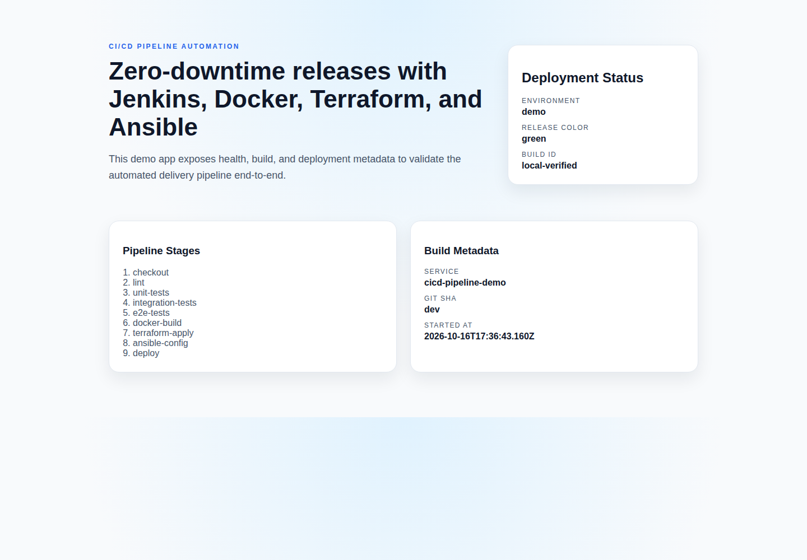
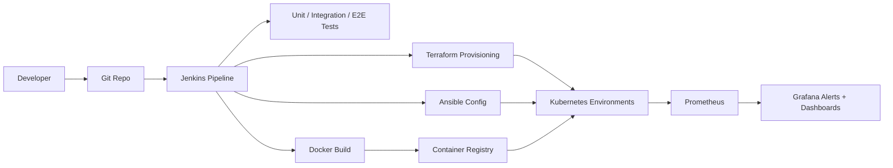

# CI/CD Pipeline Automation


<!-- LOCAL_WINDOWS_RUNTIME_20261004 -->
**This workstation — Windows configuration checked 4 October 2026.**
This project is under `G:\Projects\Portfolio`. Use the existing explicit launchers below with DevTools PowerShell; they select the managed runtimes independently of a previously opened shell.
- [DevTools.ps1](DevTools.ps1): Node 26.11.1; Test/Build.

Exact local paths, recovery, dated test scope and Windows/Linux separation: [Portfolio runbook](../../PORTFOLIO_RUNBOOK.md#workstation-verification--4-october-2026).
The generic Make/Docker examples below describe their own environments; they do not prove use of the Windows runtime. No application, container, external integration or test was started for this documentation check.
<!-- /LOCAL_WINDOWS_RUNTIME_20261004 -->

## Build and deployment automation

Make application releases repeatable and give the team a documented recovery path.

**What I can deliver:** Build/test pipelines, container packaging, infrastructure plan checks and demonstrated rolling, blue/green and canary releases.

**Skills demonstrated:** Jenkins, Docker, Terraform, Ansible, Kubernetes, CI/CD.

[Browse the feature screenshots](screenshots/README.md) · [Services and project enquiries](../../README.md#discuss-a-project)



*Actual demonstration capture. Release strategies are demonstrated locally; availability objectives depend on the target system and its acceptance tests.*

<details>
<summary>Technical documentation: features, architecture, setup and tests</summary>

## Demo
- Live: local demonstration; use the commands below.
- Screenshots:
  
  
  
  
- Local: http://localhost:8080 (after `make dev`)

## Why this exists
Teams often ship changes through inconsistent pipelines that are hard to audit
and impossible to reproduce. This project standardizes CI/CD for web
applications: Jenkins orchestrates builds and tests, Docker packages immutable
images, Terraform provisions environments, Ansible applies configuration, and
Kubernetes deploys with blue-green or rolling strategies. Prometheus and Grafana
surface health and deployment signals across every environment.

## Earlier local HTTP observability verification — 26 October 2026

The completed-request Counter and Histogram are registered before JSON parsing
and static serving. Static GET/HEAD/304 and rejected JSON400/413 responses are
counted once. API routes use their registered paths; unmatched/static/parser paths
use the bounded `unmatched` label. A scrape reports earlier completed scrapes,
excluding itself until its response finishes. Keep-alive recovery after malformed
JSON is verified on the same connection.

Five additional native HTTP tests bring the suite to21 passing tests on Node26.11.1;
lint also passes. Seven deployment-routing tests use a fake kubectl and do not
certify a live cluster. The canonical Windows environment now matches all177
locked packages, including dotenv18.0.8,supertest7.3.1 and ESLint10.13.0. A clean
installation with scripts disabled was checked against the locked tarballs:
2963 regular package files match exactly. The21 tests and lint pass on the clean
candidate and active environment; the normal DevTools.ps1 Test entry also passes.
Real deployment validation remains outstanding. This earlier batch used the now
retired prom-client 15.1.3. The replacement and current test results follow below.

## Delivery and metrics verification — 26 October 2026

The active metrics client is `@prometheus-io/client` 0.16.1, admitted and verified in
the prior dependency update. The normal Windows entry now passes **127/127 tests**
and lint. The candidate passed the same complete suite before integration.

Blue-green and rolling delivery render the requested `APP_NAME` and `NAMESPACE`
consistently across resource identities, selectors and ConfigMap references. All
local preparation completes successfully before any remote write or kind image load.
Malformed names, invalid loading flags, missing required kind and nested rendering
failures stop delivery. A command emitting output before failing cannot apply that output.
Missing resources still use create-only semantics, existing configuration is preserved,
and traffic changes follow rollout readiness.

The 46 delivery regressions pass with both isolated command recording and native
kubectl 1.36.5 local transformations. The original batch had 15 failing cases; a
first candidate required one correction for nested Bash error propagation. Test
fixtures contain hashed snapshots of the seven YAML manifests; a changed manifest
requires refreshing its snapshot using kubectl locally. No YAML parser dependency was added.

These checks simulate remote Kubernetes operations. Real cluster deployment, kind
image ingestion, Jenkins, Terraform providers and live monitoring remain unverified.
The counts in the dated sections below describe earlier verification batches.

## Monitoring uptime regression — 26 October 2026

The Grafana uptime panel now uses `time() - process_start_time_seconds{job="cicd-demo"}`,
matching the gauge exported by the active @prometheus-io/client0.16.1 and the configured scrape job.
The new integration test checks actual local HTTP metrics, gauge semantics and health
uptime using monotonic samples. Protected delayed-response and wrong-value probes pass;
the normal Windows entry passes87/87 tests and lint. These checks validate the source
contract; Prometheus evaluation and Grafana provisioning/rendering remain unverified.
The replacement dependency was admitted by Defender, activated, and verified through the normal project entrypoint.

## Dashboard regression verification — 26 October 2026

The one-shot dashboard validates both API payloads before rendering. HTTP,
transport, JSON, or payload-shape failures mark all six metadata fields and the
pipeline list unavailable; build metadata no longer remains stuck at Loading.
Labels are inserted as literal text. Seven UI regression tests exercise failures,
completion order, and a late successful peer after an error. The full suite has
28 passing tests on the candidate and active source; lint passes. Browser checks
confirm the original failure and corrected error/success states using local API
fixtures. These checks do not certify deployed Jenkins or Kubernetes services.

## CI orchestration verification — 26 October 2026

The CI entrypoint rejects invalid deployment modes, release colors, boolean
stage flags and Terraform environment identifiers before package installation
or infrastructure commands. Unset/empty defaults and supported strategies remain
compatible. Isolated tests record exact command order, arguments and metadata,
exercise failure propagation and explicit Kubernetes context paths. The full
candidate and active suites now pass 86 tests; lint passes. Commands use recording
fixtures; these tests do not certify real deployments or Jenkins runs.

## Features
- Jenkins pipeline with build, test, container, and deploy stages.
- Docker image packaging with environment-specific tags.
- Terraform provisioning for Kubernetes namespaces and optional AWS/EKS targets.
- Ansible configuration management for environment settings and rollouts.
- Blue-green and rolling deployment options with zero downtime.
- Prometheus metrics and Grafana dashboards for monitoring and alerting.

## Architecture


Jenkins orchestrates testing, image builds, provisioning, and deployments.
Terraform creates the environment on Kubernetes, Ansible applies configuration
and rollout options, and the deployment pulls immutable Docker images. Metrics
and alerts flow to Prometheus and Grafana to validate releases and uptime.

## Tech stack
- Backend: Node.js + Express for a lightweight demo web service.
- Containerization: Docker for immutable, reproducible images.
- Infra: Terraform + Kubernetes for environment provisioning, with AWS-ready inputs.
- Config management: Ansible for config templates and rollout actions.
- CI/CD: Jenkins for pipeline orchestration.
- Observability: Prometheus + Grafana for metrics and alerts.
- Tests: Node.js built-in test runner + Supertest for unit, integration, and e2e coverage.

## Quickstart (local)
Prereqs:
- Node.js 26.11+
- Docker and Docker Compose
- Make (optional)

Run:
```
cp .env.example .env  # optional
make dev
# or: make dev-app
```
`make dev` runs the app plus Prometheus and Grafana via Docker Compose.

Access:
- App: http://localhost:8080
- Prometheus: http://localhost:9090
- Grafana: http://localhost:3000 (admin / admin)

Endpoints:
- `/health`
- `/api/info`
- `/api/status`
- `/metrics`

Kubernetes demo (optional):
```
make kind-up
make docker-build
make deploy-blue
KUBECONFIG="$PWD/.kube/config" kubectl --context kind-cicd-demo -n cicd-demo port-forward svc/cicd-demo 8080:80
make deploy-green
```
Rolling strategy:
```
make deploy-rolling
```

CI pipeline simulation (optional):
```
RUN_TERRAFORM=true RUN_ANSIBLE=true RUN_DEPLOY=true \
DEPLOY_MODE=blue-green RELEASE_COLOR=green IMAGE_TAG=local \
make ci
```

Infrastructure provisioning (optional):
```
make terraform-apply
make ansible-config
```

AWS EKS (optional, existing cluster):
```
TF_ENV=aws-eks TF_VAR_cluster_name=your-eks IMAGE=cicd-demo:local make terraform-apply
```

## Terraform entrypoint regression — 26 October 2026

33 new cases exercise the real Makefile, CI script and Terraform gate with recording
fixtures for external commands. They cover full image references, context paths,
invalid inputs, stale JSON, exact saved-plan application, policy rejection and
failure ordering. All 86 tests pass through the Windows project entrypoint too.
These tests perform no real deployment and do not certify live providers or policies.

Tests require Bash and GNU Make. On this workstation, `./DevTools.ps1 -Action Test -Offline`
selects the verified central tools and restores the caller's selector
variables afterwards. Elsewhere, `BASH_EXECUTABLE` and `MAKE_EXECUTABLE` can select
the installed binaries; POSIX defaults are `/bin/bash` and `make`.

## Tests
```
make test
# or:
npm run test:unit
npm run test:integration
npm run test:e2e
```

## Security
Secrets: use `.env` (see `.env.example`). Never commit real credentials. Store
registry, Jenkins, and cloud keys in a secret manager or Jenkins credentials
store. Threat model: untrusted web requests and CI/CD credentials exposure;
mitigate with RBAC, least-privilege IAM, and network policies in production.

## Notes / limitations
- Current regression scope: 127 isolated local tests pass. Historical deployment evidence remains dated; live cloud/cluster/Jenkins revalidation is separate and requires the relevant environment.
- Jenkins pipeline assumes Docker, Terraform, kubectl, and Ansible are available.
- AWS EKS environment expects an existing cluster; cluster provisioning not included.

## Project structure
- `src/`: Express API and metrics endpoints.
- `public/`: Static UI for build/deploy metadata.
- `screenshots/`: Demo images for the README.
- `tests/`: Unit, integration, and end-to-end tests.
- `monitoring/`: Prometheus config and Grafana dashboard provisioning.
- `k8s/`: Blue-green and rolling Kubernetes manifests.
- `terraform/`: Reusable module plus local-kind and AWS EKS environments.
- `ansible/`: Playbooks and templates for app configuration.
- `scripts/`: CI/CD helper scripts and deployment wrappers.
- `Jenkinsfile`: Pipeline definition.

## Roadmap / tradeoffs
- OPA/Conftest gates check Terraform/HCL and Kubernetes manifests through `make policy` and required root CI. Before applying infrastructure, validate the exact saved plan with `python ../../scripts/check-policy.py . --plan plan.json`; see [policy coverage](../../policies/README.md).
- Canary deployments use shared Helm/Argo health gates alongside the existing blue-green and rolling strategies; see the executable example below.
- Tradeoff: blue-green releases double temporary capacity to reduce risk.

## Decisions and rationale
- Jenkins remains common in enterprise environments, so it anchors the pipeline.
- Terraform standardizes environment creation and keeps infra auditable.
- Ansible is used for repeatable config changes across environments.

## Tags
devops, docker, jenkins, ansible, terraform, kubernetes, ci/cd

## Skills and tools
Tools and software: jenkins, docker, terraform, ansible, kubernetes, prometheus,
grafana.

Skills: devops, ci/cd.

## Terraform Kubernetes provider migration

New configurations use the versioned `kubernetes_*_v1` resources with provider 3.3.
If upgrading an existing deployment, back up its state (`terraform state pull`)
and inventory every address with `terraform state list` first. Before running a
plan with the renamed configuration, remove each old address from state and
import the same existing Kubernetes object at its new address. For example:

```bash
terraform state rm 'module.app.kubernetes_namespace.app'
terraform import 'module.app.kubernetes_namespace_v1.app' <existing-namespace>
```

Repeat for every renamed resource, using its actual namespace/name as the import
ID (a namespace uses its name only). Preserve state and stop on an import error;
never apply a destroy/create plan to perform this migration. After all imports,
review the plan for unintended replacements. CI validates configuration only;
it does not migrate state or provision a cluster.

See the [provider's versioned resource migration guide](https://registry.terraform.io/providers/hashicorp/kubernetes/latest/docs/guides/versioned-resources).

## Verified deployment behavior

For `TF_ENV=local-kind`, the helpers use the project-local `.kube/config`. Other
Terraform environments preserve the agent's configured kubeconfig/current context;
`KUBECONFIG` and `KUBECONTEXT` can select an explicit external target.
Run `make kind-up` and `make docker-build` before `make terraform-apply`.
That target initializes Terraform, saves and checks the plan, then loads `IMAGE`
into kind (unless `LOAD_KIND_IMAGE=false`) and applies the exact saved plan.
Invalid inputs and rejected policies prevent both kind-load and apply. Ansible requires a supported POSIX control node; the tested
ansible-core 2.21.5 supports Python 3.12–3.14.

Ansible renders the ConfigMap with defaults or `-e` overrides. Repeat application
is idempotent. Already-running pods read environment variables at startup; deploy
a new image or explicitly roll out the affected deployment after configuration
changes. Blue/green and rolling scripts wait for readiness before replacing the
Service selector. A failed rollout leaves the current traffic selector intact.

`npm test` covers the HTTP API, metrics and routing failure behavior.
`bash scripts/test-ansible.sh` runs nine native Ansible scenarios with a recording
kubectl fixture. They check all five rendered values, repeated execution with zero
changes, quoted context/path arguments, local/external defaults, merged kubeconfig
paths, manifest stdin, and stopping at three backend failures. The candidate and
active suites pass with Ansible2.21.5/Python3.12.3; all86 Node tests still pass.
The playbook and templates are unchanged; no real cluster is contacted.

Use a POSIX Python with ansible-core installed. The launcher defaults to `python3`;
`ANSIBLE_TEST_PYTHON` selects an explicit interpreter. `--output <new-directory>`
retains native logs; otherwise reports and fixtures are temporary and cleaned up.
The existing GitHub workflow already calls this launcher; its Python3.14 execution
has not been revalidated by this local audit.
The Jenkinsfile is a template requiring an agent with Docker, kind/kubectl,
Terraform, Ansible and the intended credentials/context; the local CLI proofs do
not imply that an arbitrary Jenkins installation is already configured.

## Verified plans and canary delivery

`bash scripts/terraform-gate.sh plan` saves `release.tfplan`, extracts its JSON
and checks the shared OPA policies. `apply` re-extracts and rechecks that saved
plan, then applies that exact plan without recalculating variables. These files
may contain sensitive state; they are Git-ignored and are not Jenkins artifacts.
The Makefile, Jenkins and local CI routes use this gate. Full `IMAGE` references
(including registry ports and digests) take precedence for direct gate/Make use.
Local CI explicitly passes the image it built and avoids a second kind-load.
Direct gate calls default `LOAD_KIND_IMAGE=false`; `plan` never loads or applies.
For existing-plan `apply`, `LOAD_KIND_IMAGE=true` is rejected because current
image variables cannot establish which image is inside an older saved plan. Conftest, Helm and Python are
required on the agent alongside Terraform.

For canary, install Argo Rollouts in the local test cluster and select
`DEPLOY_MODE=canary RUN_DEPLOY=true RUN_TERRAFORM=false`. Jenkins exposes the same
choice through `AUTO_DEPLOY`; `AUTO_APPLY` is deliberately incompatible because
Helm owns canary workloads. The common release command creates `canary-cicd-demo`,
checks `/health` through AnalysisTemplates and aborts unhealthy candidates.
Select the context explicitly for non-kind targets. Blue/green and rolling routes
retain their existing Terraform management and namespaces.

```bash
DEPLOY_MODE=canary RUN_DEPLOY=true ./scripts/ci.sh
python ../../scripts/release-environment.py remove --mode canary --id cicd-demo --context kind-cicd-demo
```

The first deployment tests readiness; later revisions exercise progressive
analysis. See the [shared deployment demonstration](../../GitOps%20Platform%20-%20Argo%20CD%20%26%20Helm/README.md)
for preview ownership, approximate replica weights and cleanup.

## Verified screenshots

See the [per-function screenshot index](screenshots/README.md) for the existing local demonstration flows and their verification scope.

</details>
