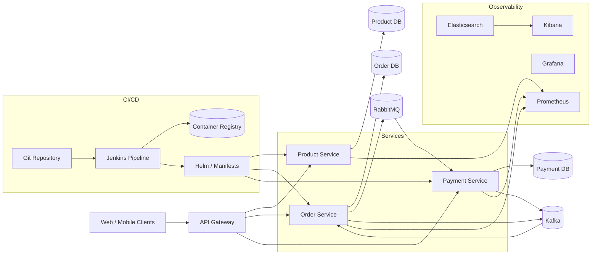

# Cloud-Native E-Commerce Platform

Cloud-native e-commerce platform for teams that need reliable product, order, and payment APIs with event-driven workflows.

This project demonstrates a production-minded microservices baseline with REST APIs, async messaging, and Kubernetes-ready operational patterns.

## Features
- Product, order, and payment REST APIs with independent data stores
- RabbitMQ command queue for payment requests
- Kafka event streams for order and payment events
- Docker Compose for one-command local run
- Kubernetes manifests for deployments and services
- Prometheus metrics and optional Grafana/Kibana observability stack

## Tech stack (and why)
- Backend: Python 3.15 and FastAPI for RESTful APIs.
- Messaging: RabbitMQ for command queues, Kafka for durable event streams.
- Infra: Docker Compose for local dev; Kubernetes manifests for deployment.
- CI: Jenkins pipeline for lint, test, build, and container publishing.
- IaC: Terraform scaffold for AWS EKS baseline.
- Observability: Prometheus + Grafana for metrics; Elasticsearch + Kibana for logs.

## Demo
- Live: local demonstration; use the commands below.
- Screenshots:
  - `screenshots/20251228_1734_Cloud-Native E-commerce Architecture_simple_compose_01kdjsf76werharaf9884tex8p.png`
  - `screenshots/20251228_1734_Cloud-Native E-commerce Architecture_simple_compose_01kdjsf76xe659xjahv3y1accm.png`
  - `screenshots/20251228_1734_Cloud-Native E-commerce Architecture_simple_compose_01kdjsf76yfdg994q313qzs4gg.png`
  - `screenshots/20251228_1734_Cloud-Native E-commerce Architecture_simple_compose_01kdjsf76zfn18b0ygm0jsjr3y.png`


## Quickstart (local)
Prereqs:
- Docker and Docker Compose

Run:
```bash
export JWT_SECRET="$(openssl rand -hex 32)"
make dev
```

In the same shell (or a shell with the same `JWT_SECRET` value exported), obtain a short-lived local admin token:
```bash
export ADMIN_TOKEN="$(docker compose exec -T gateway python -m app.issue_token --subject local-admin --role admin)"
```
The development issuer requires access to the gateway's signing key. It is not a public login endpoint.
Use `--subject <customer-id> --role customer` for a customer token. Tokens expire after 15 minutes.

Create a product:
```
curl -X POST http://localhost:8088/products \
  -H "Authorization: Bearer $ADMIN_TOKEN" \
  -H "Content-Type: application/json" \
  -d '{"name":"Coffee Beans","description":"1kg bag","price_cents":1899,"currency":"USD"}'
```

Create an order:
```
curl -X POST http://localhost:8088/orders \
  -H "Authorization: Bearer $ADMIN_TOKEN" \
  -H "Content-Type: application/json" \
  -d '{"customer_id":"cust-123","items":[{"product_id":"<PRODUCT_ID>","quantity":2}]}'
```

Check order status:
```
curl -H "Authorization: Bearer $ADMIN_TOKEN" http://localhost:8088/orders/<ORDER_ID>
```

RabbitMQ UI:
- http://localhost:15672 (guest / guest)

Optional observability stack:
```
docker compose -f docker-compose.yml -f docker-compose.observability.yml up --build
```

## Architecture


Data flow: orders are created via REST, the order service publishes a payment request to RabbitMQ, the payment service processes the request, emits a payment event to Kafka, and the order service consumes that event to update order status. CI/CD builds images, pushes to a registry, and deploys via Helm or manifests.

## Tests
```
make test
make integration-test
```

The integration test uses a unique disposable Compose project with loopback-only,
random API ports. It exercises the real RabbitMQ/Kafka payment flow, duplicate
payment requests, and recovery after stopping each broker. Only its own containers,
networks and volumes are removed on completion.

Payment requests are confirmed by RabbitMQ before success is reported. Orders and delivery records are
saved in one database transaction. If delivery fails, the API returns HTTP 503 with the saved `order_id`
and `retry_url`; a dispatcher retries pending records automatically, including after service restarts.
Do not create another order. `POST /orders/{order_id}/retry-delivery` remains available to request an
immediate attempt on existing pending records. Payment consumers acknowledge RabbitMQ only after
Kafka confirms the saved result. Redelivery republishes the same payment, and
order status updates are idempotent. Direct payment retries reuse `order_id`;
changed amount/currency is rejected with HTTP 409.


## Security
Secrets: use `.env` (see `.env.example`). The only published application API is the JWT gateway on
loopback port 8088. It validates signature, issuer, audience and expiration; product mutations and payment
administration require `admin`. Customers can view/cancel only their own orders and cannot select another
customer ID when ordering. Redis enforces a configurable request limit per signed subject; store failures
fail closed. This is an application rate limit, not a WAF. Internal service APIs trust the private network:
do not expose them directly. For production, provision a managed issuer, TLS, private broker/database
access and Kubernetes network policies. Local database defaults and RabbitMQ guest credentials are demo-only.

## Persistence and saga workflow
- Compose uses three separate PostgreSQL databases/volumes for products, orders and payments.
- `POST /orders/{id}/cancel` starts refund compensation for a paid order: `paid` → `cancel_pending` → `cancelled`.
  The payment becomes `refunded`; repeated cancellation/refund messages are idempotent. Late authorization
  events cannot overwrite cancellation. Payments/refunds are simulated business operations, not bank transactions.
- The transactional outbox removes a record only after RabbitMQ and Kafka acknowledge publication.
  Delivery is at least once; consumers deduplicate business operations. Pending rows remain observable in
  the `outbox` table with attempts and last error class. A persistent broker failure remains pending.
- `DATABASE_URL` selects PostgreSQL. Omitting it retains SQLite for isolated unit tests and legacy data.
  Existing SQLite volumes are preserved; they are not automatically imported or deleted. Back them up and
  perform an explicit reviewed data migration before adopting PostgreSQL for an existing deployment.

## Tradeoffs
- The local issuer, single-node databases/brokers and process-level dispatch locks are demonstration choices.
  Multiple dispatchers can republish a record; idempotent consumers preserve the result.
- Contributor tasks: `docs/contributor-tasks.md`.

## Notes / limitations
- Use independently managed PostgreSQL credentials and backups outside the local demonstration.
- Observability stack is optional; Kibana requires a log shipper (see `monitoring/filebeat/`).
- The local RabbitMQ manifest keeps a stable hostname across pod replacements. Its non-root
  init container restricts the existing Erlang cookie to mode `0600`; `OnRootMismatch` prevents
  unnecessary recursive group-permission changes on an already prepared volume. This preserves
  RabbitMQ's owner-only cookie requirement after a cluster restart. Existing deployments that used
  pod-derived RabbitMQ node names need an explicit data migration before adopting a different node
  identity; the demonstration does not migrate or delete those older directories automatically.

## Decisions and rationale
- Split by business capability to keep services independently deployable.
- Used RabbitMQ for command-style messaging and Kafka for event streams.
- Chose FastAPI to keep implementation compact while remaining production-friendly.

### Mirroring to GitHub
- Keep local-only files in local Git excludes (e.g., `.git/info/exclude` or a global gitignore).
- Commit in logical chunks with clear messages.
- Push after README/CI/quickstart remain accurate.
- Keep Actions, Dependabot, and secret scanning enabled.

## Performance
Local benchmark harness:
- Script: `perf/k6/products-load.js`
- Run: `k6 run perf/k6/products-load.js` (set `BASE_URL` to target another host)
- Scenario: 10 VUs for 30s, `POST /products` + `GET /products`
- Baseline (local Docker Compose):
  - Avg latency: 16.69 ms
  - p95 latency: 73.23 ms
  - Throughput: 19.04 req/s
  - Errors: 0.00%

## Verified screenshots

See the [per-function screenshot index](screenshots/README.md) for the existing local demonstration flows and their verification scope.
