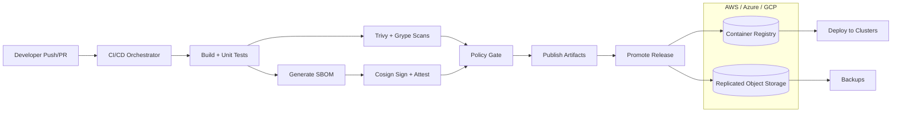

# DevSecOps Pipeline with SBOM & SLSA

Automated CI/CD pipeline template for regulated teams that need SBOMs, signed artifacts, and policy gates across AWS, Azure, and GCP.

## Demo
- Live: TBD
- Video or GIF: TBD
- Screenshots:
  - `demo/pipeline-architecture.svg`
  - `demo/pipeline-artifacts.svg`


## Why this exists
Supply chain risk and compliance requirements make it hard to ship quickly without compromising auditability. This project standardizes SBOM generation, dependency and container scanning, artifact signing, and policy gates so teams can produce repeatable, verifiable releases across multi-cloud environments.

## Features
- Generates SBOMs (CycloneDX) for container images.
- Scans dependencies and images with Trivy and Grype and enforces severity thresholds.
- Signs images, SBOMs, and provenance attestations with Cosign.
- Policy gates block releases that fail vulnerability checks.
- Local artifact replication into three named storage folders and timestamped backups.
- Audit-ready metadata and repeatable release promotions.

## Architecture


CI builds produce artifacts and SBOMs, which are scanned and signed before policy gates allow promotion. The local implementation copies signed artifacts into filesystem folders named aws, azure and gcp, and pushes the image to a local registry. Real multi-cloud storage, availability and deployment require external integrations.

## Tech stack (and why)
- GitHub Actions: repo-native CI workflows with policy gates and traceable runs.
- Jenkins: enterprise CI option for hybrid environments and regulated networks.
- Docker: reproducible image builds and scan targets.
- Kubernetes: resilient runners and controlled deployment environments.
- Terraform: multi-cloud IaC for CI, storage, and registries.
- Trivy + Grype: complementary vulnerability scanners for dependencies and images.
- Cosign: artifact signing and SLSA-style attestations.

## Quickstart (local)
Prereqs:
- Docker
- Make (optional)

Run:
```
cp .env.example .env
# Bash: enter a private password for the local signing key.
read -rs -p "Local signing password: " COSIGN_PASSWORD; echo
export COSIGN_PASSWORD
make dev
```

Outputs:
- `artifacts/`: SBOM, scanner reports, image digest, signature bundle, generated provenance and verification results.
- `storage/`: replicated artifacts for AWS/Azure/GCP simulation.
- `backups/`: timestamped backups of artifacts.

Verify signatures:
```
make verify
```

Stop local registry:
```
make down
```

## Tests
```
make test
```

## Security
Secrets: use `.env` for local Cosign keys, prefer KMS or keyless OIDC in CI, keep registry and artifact storage access in least-privilege IAM roles, and enforce policy gates before promotion. Enable secret scanning and dependency alerts in GitHub.

## Notes / limitations
- Local storage is simulated with filesystem replication; replace with S3/Blob/GCS in production.
- The demo pipeline signs with a local key; CI can switch to keyless signing via OIDC.

## Roadmap / tradeoffs
- Add SLSA level 3 provenance with isolated builders and hermetic builds.
- Add policy-as-code bundles for license and provenance enforcement.
- Tradeoff: stronger gates improve security but slow down release throughput.

## Decisions and rationale
- Containerized scanners keep local requirements minimal.
- Local registry enables image signing and attestations without external dependencies.
- File-based replication provides a fast local simulation of multi-cloud object storage.

## Project structure
- `app/`: demo container image used by the pipeline.
- `demo/`: pipeline architecture and artifact replication visuals.
- `scripts/pipeline.sh`: local end-to-end pipeline runner.
- `policy/provenance.json`: illustrative predicate; the runner generates the signed predicate from the actual Dockerfile hash and pushed image digest.
- `ci/github-actions/pipeline.yml`: GitHub Actions pipeline template.
- `ci/jenkins/Jenkinsfile`: Jenkins pipeline template.

## Tags
security, docker, kubernetes, ci/cd, devsecops, github actions, sbom, slsa

## Skills and tools
Tools and software: docker, jenkins, terraform, kubernetes, github actions, trivy, grype, cosign.

Skills: java, security, kubernetes, spring boot, ci/cd.

## Local signing and verification boundary

The example selects `LOCAL_DEMO=1` with a loopback registry. This mode verifies
signatures against the local public key without uploading artifacts to a public
transparency log. It rejects remote registry/image overrides. Outside this explicit
mode, Cosign's transparency-log behavior remains enabled. Local signatures and
SLSA-format metadata do not establish a certified SLSA level or trusted CI builder.

The runner freezes the pushed image digest before SBOM generation and scanning,
then signs that same digest. The generated provenance includes the actual
Dockerfile SHA-256. `make verify` checks the image, SBOM bundle and attestation;
a different selected image, missing inputs or modified SBOM fails verification.
The High/Critical Trivy and High Grype gates remain enforced.

Use `SCANNER_CACHE_DIR` to select an existing managed cache and `ENV_FILE` to select
a dedicated environment file. Relative artifact/storage/key paths in `.env` are
resolved against this project. Keys and signing passwords remain local and ignored.
