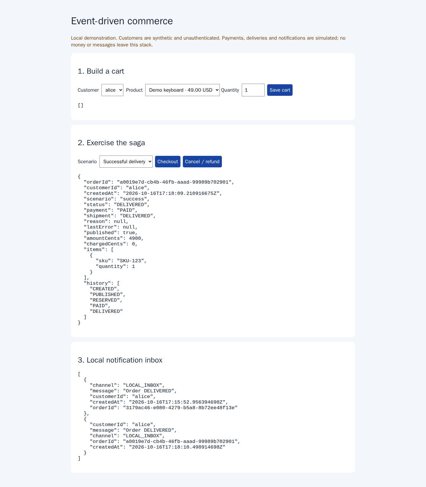
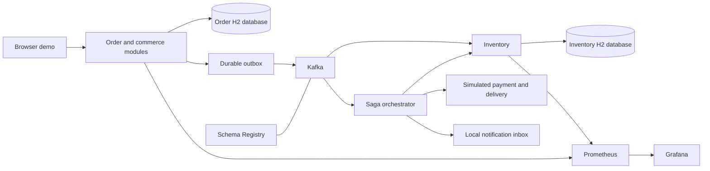
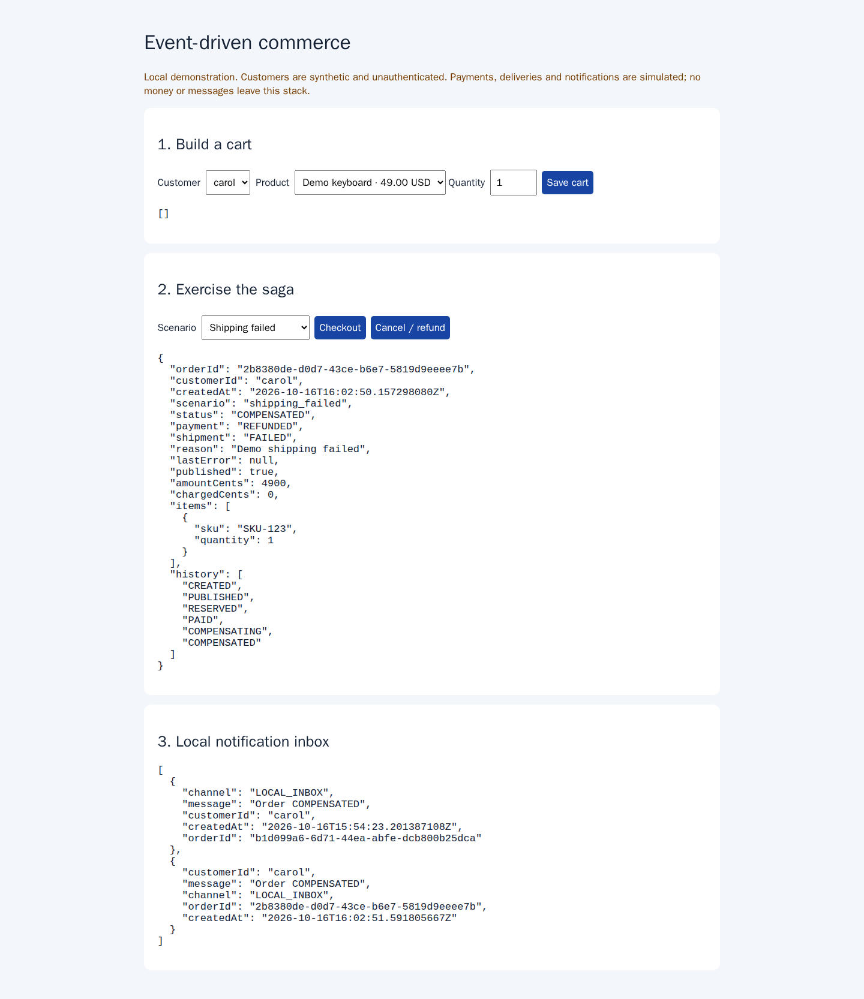

# Event-Driven E-Commerce Platform

## Java integrations and order workflows

Coordinate checkout, inventory, payments and delivery across asynchronous services.

**What I can deliver:** Spring Boot APIs and Kafka workflows with order history, compensation, simulated refunds and an operator-visible event trail.

**Skills demonstrated:** Java, Spring Boot, Kafka, H2, Schema Registry, Terraform.

[Browse the feature screenshots](screenshots/README.md) · [Services and project enquiries](../README.md#discuss-a-project)



*Actual demonstration capture. Payment, delivery and notification providers are simulated locally; workflow persistence and failure recovery are exercised.*

<details>
<summary>Technical documentation: features, architecture, setup and tests</summary>

## Run the demonstration

```sh
docker compose up --build -d
```

Open [the commerce demo](http://localhost:18081). Choose a synthetic customer, save a cart and select a successful, declined-payment or failed-shipping scenario. The order shows its durable saga history. Notifications appear in the local inbox. Cancellation is asynchronous: a 202 response means compensation is queued; poll until `COMPENSATED`.

| Component | Address |
| --- | --- |
| Commerce UI/API | http://localhost:18081 |
| Inventory | http://localhost:18082/api/inventory/SKU-123 |
| Schema Registry | http://localhost:18083/subjects |
| Prometheus | http://localhost:9091 |
| Grafana | http://localhost:13000 — local demo login admin/admin |

The ports bind only to loopback. These APIs use synthetic customer IDs, without production authentication; do not expose the stack publicly or use personal data. Named volumes retain both service databases and Kafka data. `docker compose down` stops the demonstration; `docker compose down -v` also deletes **this stack's demo data**.

For the automated exercise, from the repository root:

```sh
python scripts/demo-check.py event-driven
# Add --keep to retain a successful isolated instance for a walkthrough.
```

The checker creates a separate stack, fresh volumes and random loopback ports. It verifies contracts, dead letters, duplicate events, atomic stock reservation, success/decline/shipping failure, notifications, broker outage/recovery, restart persistence and idempotent cancellation. It removes its own stack afterward.

## Implemented behavior

- Three catalog products with server-owned integer-cent prices; customer-specific persisted carts and checkout idempotency keys.
- H2 file database per service. Inventory transactions lock the state row, atomically reserve all items and reject overselling, including concurrent database clients.
- Durable checkout outbox. Kafka publication and inventory HTTP calls run **outside database transactions**, so an unavailable dependency does not block reads or new checkouts.
- Saga orchestration: reserve → simulated payment → simulated delivery → local notification. A declined payment releases stock; failed shipping refunds the simulated payment and releases stock. Interrupted compensation stays visible and resumes.
- Idempotent reservations and compensation tombstones: delayed Kafka delivery cannot reserve stock after cancellation. Conflicting reuse of an order ID is rejected.
- Both services validate the same bundled JSON Schema. Confluent Schema Registry stores `order.created-value` with BACKWARD compatibility; an incompatible change fails registration.
- Explicit `order.created.DLT` handling, bounded consumer retries and producer acknowledgement errors.
- Real Prometheus HTTP metrics, order counts by saga status and a zero-charge gauge in the Grafana dashboard; no external telemetry account.

The demo intentionally consolidates catalog/cart/payment/shipping/notification modules in the Order process. Inventory remains an independently deployed service with its own database. This demonstrates the full workflow and failure recovery without pretending that seven independent production services or a real payment/courier integration exist.



## Terraform and Jenkins

`infra/terraform` provisions the actual local Docker network, Kafka, Schema Registry, service images and five persistent volumes through the pinned Docker provider. It uses the local engine as the demonstrative infrastructure target; it does not create AWS VPC/MSK/EKS/ECR resources or incur cloud costs.

```sh
cd infra/terraform
terraform init
terraform plan -out=demo.tfplan
terraform apply demo.tfplan
# Once finished, review and apply destruction of this dedicated demo:
terraform plan -destroy -out=destroy.tfplan
terraform apply destroy.tfplan
```

Default API ports are 28081/28082. Set `docker_host` only when the provider needs an explicit engine endpoint; preserve the engine used by other projects. Use a distinct `name` and ports for concurrent demos. Destruction removes only resources recorded in this Terraform state, including its synthetic data volumes.

The root-project `Jenkinsfile` runs Java tests, the isolated integration exercise and Terraform validation. Its optional KEEP_DEMO stage publishes images to the **local Docker engine** and retains the verified demo with an exact cleanup command. The agent needs Java 25, Maven, Python, Terraform and Docker. AWS remains an architectural mapping (network ↔ VPC, Kafka ↔ MSK, containers ↔ EKS, local image store ↔ ECR), not an untested cloud deployment claim.

## Tests and contracts

`make test` runs both Java suites. Tests cover schema violations, real H2 transactions/restarts, concurrent reservations, outbox retries, compensation and cancellation while publication is blocked. The integration checker also sends an incompatible schema to the real registry and requires HTTP 409.

- [API](docs/api.md)
- [Event contract and recovery](docs/events.md)
- [JSON Schema](services/order-service/src/main/resources/order-created.schema.json)
- [Terraform Docker provider](https://registry.terraform.io/providers/kreuzwerker/docker/4.6.0/docs)
- [Schema Registry API](https://docs.confluent.io/platform/current/schema-registry/develop/api.html)
- [NetworkNT validator 2.0.8](https://github.com/networknt/json-schema-validator/tree/2.0.8) — compatible with this Spring Boot application's Jackson 2.

## Demonstration boundaries

There are no real charges (`chargedCents=0`), courier bookings or external messages. The displayed order total is a simulated price, not money collected. H2 and the single document per service favor a reproducible demo over large-scale throughput; no production scalability guarantee is made. The checked-in screenshots are illustrative architecture material; the executable browser flow is served by Order.


## Captured functional demonstration

Failed shipping with completed refund and local notification. Captured from the running local application on 16 October 2026.



## Verified screenshots

See the [per-function screenshot index](screenshots/README.md) for the existing local demonstration flows and their verification scope.

</details>
