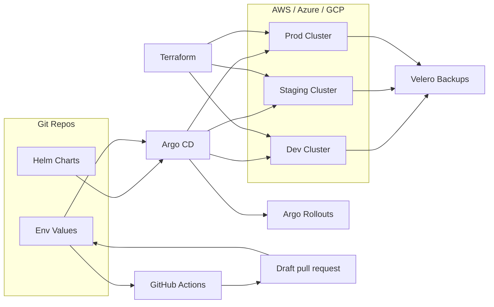
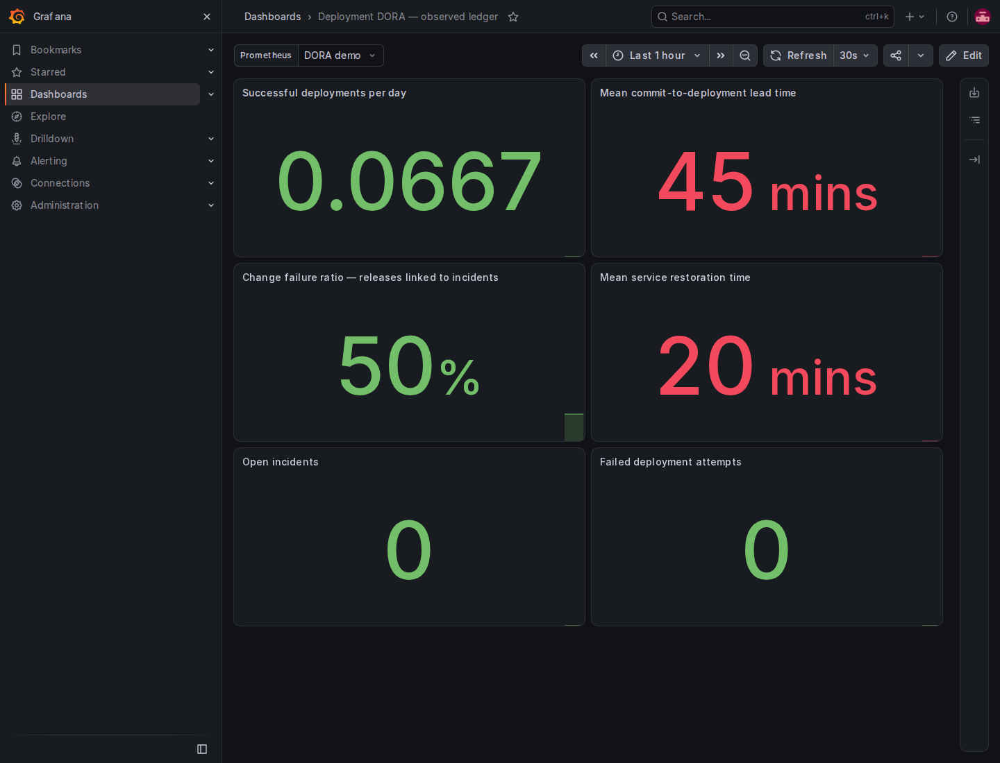

# GitOps Platform - Argo CD & Helm

GitOps delivery platform for platform engineers and SREs who need repeatable, auditable multi-environment microservice deployments with fast rollbacks and disaster recovery.

## Features
- Argo CD app-of-apps manages dev/staging/prod with drift detection and self-healing.
- Helm charts with environment-specific values stored in Git for consistent releases.
- GitHub Actions proposes environment changes in draft pull requests; reviewed merges can be reconciled by an independently configured Argo CD instance.
- Terraform provisions EKS/AKS/GKE clusters with shared networking and IAM baselines.
- Progressive delivery (canary and blue/green) with automated rollback gates.
- Velero backups for cluster state and persistent volumes to support DR.

## Tech stack (and why)
- Argo CD: GitOps reconciliation, drift detection, and audit trails.
- Helm: templated manifests and per-environment configuration.
- GitHub Actions: promotion automation plus CI checks for Helm and Terraform.
- Terraform: consistent multi-cloud provisioning for Kubernetes clusters.
- Kubernetes (EKS/AKS/GKE): managed clusters across dev/staging/prod.
- Argo Rollouts: canary and blue/green deployments with rollback controls.
- Velero: backup and restore workflows for disaster recovery.
- Docker: consistent build/runtime for CI jobs and tooling.

## Demo
Live: local demonstration; use the commands below.

Video or GIF:


Screenshots:


## Quickstart (local)
Prereqs:
- Docker
- kind
- kubectl
- Helm
- Make
- Terraform (for cloud provisioning)

Run:
```
make dev
```
This creates a local kind cluster, installs Argo CD, Argo Rollouts, MinIO, and Velero, then bootstraps the app-of-apps.
Helm overrides for the local stack live in `infra/`.

Argo CD access:
```
make argocd-password
make port-forward-argocd
```

Promote an image tag:
```
make promote ENV=staging TAG=6.5.4 STRATEGY=blueGreen
```
The root GitOps Platform Promote workflow starts from the default branch and opens
a draft PR on a unique automation branch. It never pushes directly to main,
approves a PR, or merges it. A no-op creates no branch or PR.

Repository setup: allow GitHub Actions to create pull requests, retain a read-only
default token, require Portfolio status on main, and configure dev/staging/prod
environments for default-branch deployment access. Production should require an
owner review. GitHub's creation setting also permits PR approvals; this workflow
does not use that capability. No personal access token is required.

Review the proposed diff and approve CI execution when GitHub requests it before
merging. If PR creation fails after the branch push, inspect that branch and any
existing PR instead of rerunning blindly. Argo CD and real deployments are not
started by this workflow.

Back up environments:
```
make backup
```

Cloud provisioning: see `terraform/README.md` for EKS, AKS, and GKE provisioning.

Note: the Argo CD manifests currently point to the portfolio repo and the `GitOps Platform - Argo CD & Helm` subfolder. Update the `repoURL` and `path` in `apps/bootstrap/app-of-apps.yaml` and `apps/environments/*.yaml` to match your mirrored repo before running Argo CD, then push so Argo CD can pull it.

## Architecture


Helm charts and environment-specific values live in Git. GitHub Actions proposes value changes in draft pull requests. After review, successful CI, and merge, an independently configured Argo CD instance can reconcile the new values across dev/staging/prod. Argo Rollouts handles progressive delivery and Velero handles backups. Terraform provisions the multi-cloud clusters and baseline infrastructure.

## Tests
```
make test
```
CI runs the same checks; see `.github/workflows/gitops-platform-ci.yml`.

## Security
Secrets: use `.env` (see `.env.example`). Store cloud credentials in OIDC-backed GitHub Actions secrets, restrict Argo CD access with RBAC, and enable namespace isolation plus network policies between environments. Velero backups should use encrypted buckets and least-privilege IAM roles. Enable secret scanning and Dependabot in GitHub.

## Roadmap / tradeoffs
- OPA/Conftest gates check Terraform/HCL and rendered Helm manifests through `make policy` and required root CI; see [policy coverage](../policies/README.md).
- Promotion metrics and a Grafana DORA dashboard use an explicit deployment/incident ledger; see the runnable example below. Missing lead/restore times remain absent, and failed canary attempts are separate from incidents caused by successful releases.
- Argo AnalysisTemplates check the candidate service at each partial weight and before blue/green promotion. Failed health responses abort promotion. The primary service selects both ReplicaSets during canary; dedicated stable/canary services support analysis. Without a traffic manager, weights approximate the replica ratio, not exact request percentages.
- Tradeoff: multi-cloud parity improves resilience but increases operational overhead.

## Project structure
- `apps/`: Argo CD app-of-apps and per-environment Applications.
- `charts/`: Helm chart with environment overrides.
- `demo/`: architecture illustrations; actual runtime captures are in `screenshots/`.
- `infra/`: Helm values for Argo CD and Argo Rollouts.
- `k8s/`: MinIO and Velero values plus backup manifest.
- `terraform/`: AWS, Azure, and GCP cluster baselines.
- `scripts/`: promotion helper used by GitHub Actions.
- `.github/workflows`: monorepo CI and promotion workflows for this project.
- `GitOps Platform - Argo CD & Helm/.github/workflows`: standalone workflows for a split repo.

## Tags
terraform, kubernetes, ci/cd, helm, argo cd, gitops, velero, multi-env

## Skills and tools
Tools and software: docker, terraform, kubernetes, helm, github actions, argo cd, velero.

Skills: kubernetes, devops, terraform, ci/cd.

### Azure and Google provider upgrades

The configurations validate with AzureRM 5.9 and Google 8.6. Existing deployments
must back up state and review the providers' major-version upgrade guides and a
plan before applying. Azure requires a subscription ID through the normal provider
configuration or `ARM_SUBSCRIPTION_ID`. AKS node provisioning stays `Manual`;
new clusters use the region's recommended Kubernetes version unless overridden.
Existing clusters should keep an explicit supported version and follow the service's
sequential upgrade requirements. Validation does not provision or migrate resources.

## Reproducible local cluster

`make dev` pins the tested Helm chart versions and Kubernetes node image. It uses
this project's `.kube/config` and an explicit kind context, preserving the user's
default kubeconfig. For additional commands in this shell, use:

```bash
export KUBECONFIG="$PWD/.kube/config"
make status
make backup
kubectl -n velero get backups,podvolumebackups
```

Each `make backup` creates a new backup. A completed Kubernetes-object backup alone
does not prove that file contents were saved: inspect `podvolumebackups` and test a
restore into an isolated namespace. The kind storage class is annotated to create
`local` PVs, which Velero's filesystem backup supports. Existing `hostPath` PVs are
not converted by this setting; recreate only disposable demo data or migrate real
data separately.

The public MinIO images used by the old quickstart are no longer available. The
shared `../scripts/build-local-minio.sh` builds the official server/client commits
with Go 1.27.2 and loads them into this kind cluster. This is a local demonstration
of the archived upstream software, not a maintained production-storage service.
The first source build requires network access and takes longer than cached runs.

Remove this project's test cluster with `make destroy`. Cloud accounts, real
credentials and existing clusters are outside the local quickstart.

References: [MinIO source](https://github.com/minio/minio),
[local-path volume types](https://github.com/rancher/local-path-provisioner#volume-types),
[Velero filesystem backup](https://velero.io/docs/v1.18/file-system-backup/).

Production uses `autoPromotionEnabled: false`: an update pauses after the preview
is ready and keeps the previous active version serving traffic. Inspect the
preview before using the standard `kubectl argo rollouts promote platform-service`
command in `platform-prod` with this project's kubeconfig/context. This optional
command needs the official Argo Rollouts kubectl plugin. A paused rollout is an
approval gate, not a startup failure. Roll back the Git revision to restore the
previous desired image through Argo CD.

## Preview environments and canary verification

The demo uses a local Podinfo image rebuilt from the pinned upstream 6.15.0
source with Go 1.27.2 and patched Go dependencies. `make kind-up` calls the shared
`../scripts/build-local-podinfo.sh` helper and loads the resulting image. For the
first build, provide Go 1.27.2, Python 3.12+ and Docker; configurable build and
cache locations are documented by `python ../scripts/build-local-podinfo.py --help`.
The helper verifies the source archive and public CA bundle, runs upstream Go
package tests and builds a static binary into a `scratch` image. There is no
Debian/Alpine runtime layer. Existing correctly tagged local images are reused.
The prepared source can be inspected with `--prepare-only`, then built offline
with `--build-only`; downloading source alone never executes it.

From the repository root, with Helm, Conftest, kubectl and an explicit context:

```bash
python scripts/release-environment.py deploy --mode preview --id pr-123 --context kind-gitops-platform --image-repository portfolio-podinfo --image-tag 6.15.0-security1
python scripts/release-environment.py remove --mode preview --id pr-123 --context kind-gitops-platform
python scripts/release-environment.py deploy --mode canary --id demo --context kind-gitops-platform --image-repository portfolio-podinfo --image-tag 6.15.0-security1 --events /tmp/deployments.jsonl
```

Each release uses its own `preview-<id>` or `canary-<id>` namespace. The command
refuses existing namespaces without its ownership label, validates rendered
manifests with OPA, waits for readiness and checks the observed Rollout generation.
Helm 4 uses its supported legacy wait strategy for built-in resources and client
merge for the selectors owned by Argo; the separate Argo phase/generation check
is mandatory for accepting a canary. A generic Helm watcher cannot determine this
custom resource's readiness.
Canary needs the installed Argo Rollouts controller. Analysis performs three JSON
health checks at each intermediate weight. Initial installation has no previous
version to compare; Argo skips progressive analysis for that initial revision.
A later failed candidate is aborted while the stable ReplicaSet remains available.
Inspect `kubectl get analysisruns -n canary-demo` before changing a rejected release.
Remove a canary through the same command with `--mode canary --id demo` only when
finished with that environment. Removal checks ownership and Kubernetes UID/version
preconditions. It never removes the cluster.

## DORA dashboard and reproducible ledger

```bash
python scripts/dora.py observability/demo-events.jsonl --as-of 2026-01-31T00:00:00Z
python scripts/dora.py observability/demo-events.jsonl --as-of 2026-01-31T00:00:00Z --serve 9119
```

These commands run from this project. The explicit synthetic fixture yields two
successful deployments, 45-minute mean lead time, a 50% change failure ratio and
20-minute mean restoration time. `/report` returns JSON and `/metrics` exports
Prometheus gauges on loopback. Import `observability/dora-dashboard.json` into
Grafana and select the Prometheus datasource that scrapes this exporter.

For measured data, pass `--events` to the release command and provide `--revision`
and `--committed-at` for lead time. Record incidents separately as JSONL objects
with `kind: incident`, unique `id`, `deployment_id`, `started_at` and `resolved_at`
(or null while open). Only incidents linked to successful releases count toward
change failure ratio. Failed attempts have their own metric. Repeated identical
events are deduplicated; conflicting duplicates and impossible timestamps fail.
Missing commit times or resolved incidents produce no corresponding time metric,
not a fabricated zero. The ledger defines the observation boundary and window;
it is not proof of organization-wide delivery performance.

References: [Argo analysis](https://argo-rollouts.readthedocs.io/en/stable/features/analysis/),
[basic canary weights](https://argo-rollouts.readthedocs.io/en/stable/features/canary/).

## Captured functional demonstration

Actual Grafana dashboard using the explicitly synthetic ledger. Captured from the running local application on 16 October 2026.



### Complete local DORA stack

`python scripts/demo-dora.py --keep` starts isolated Prometheus 3.15 and Grafana
13.2, imports the dashboard, verifies all six metrics through both APIs, and prints
the loopback URL and cleanup command. The fixture is evaluated as of 31 January
2026; its values are synthetic examples, not organizational performance.

The October verification also exercised native Argo CD revision reconciliation,
self-healing from five replicas back to the desired two, and a second Git revision
promoted after health analysis. Velero/Kopia restored 60,000 bytes into a different
PVC and namespace with an identical SHA-256; both volume jobs and the restore were
Completed. A successful object-only backup is not accepted as a data-restore test.
