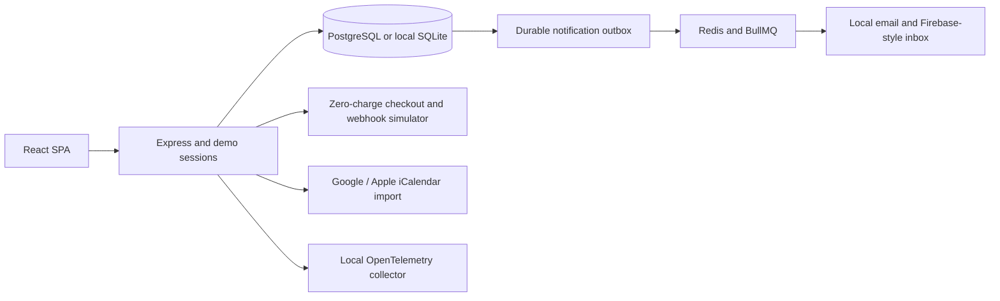
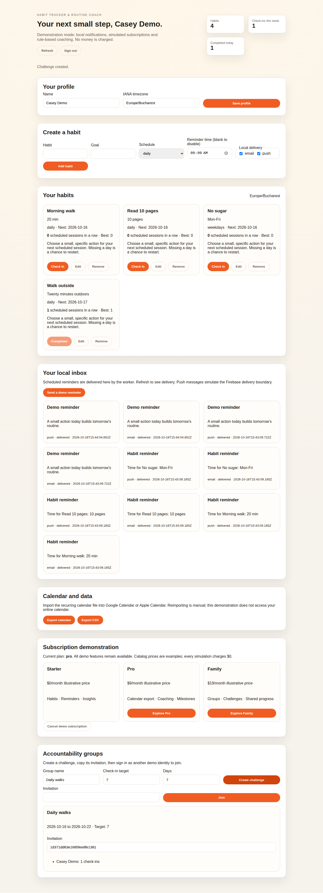

# Habit Tracker & Routine Coach SaaS

A complete local demonstration of habit tracking, coaching, reminders and shared
challenges. All identities and subscription transactions are synthetic. No external
account, card, email provider or Firebase project is required.

## Run the complete application

```bash
docker compose up -d --build
```

Open **http://localhost:8085**. Choose Alice, Bob or Casey, complete the profile and
choose an IANA timezone. Create a habit, select its recurrence and reminder time,
and check it in on a scheduled day. The same page exposes coaching, milestones,
notification delivery, subscription success/failure, calendar/CSV export and groups.

The Compose stack runs the React application and Express API, PostgreSQL, Redis
with BullMQ and an OpenTelemetry collector. Only the application publishes a port,
on loopback. PostgreSQL and Redis use named volumes. `docker compose down` stops the
demo and preserves those volumes; add `--volumes` only to deliberately reset its data.
Local database credentials are demonstration values, not production credentials.
Each application process limits clients to 240 requests per minute, including
frontend requests; excess traffic returns HTTP 429 with `Retry-After`. Health
checks and CORS preflight remain available. The local counter is per process.

## Features

- Session authentication with random bearer tokens, expiry, logout and per-identity
  authorization. The identity picker is intentionally open for a local demonstration.
- Onboarding, timezone selection, habit creation/edit/delete, daily, weekdays and
  specific weekly-day schedules. Future and off-schedule check-ins are rejected;
  concurrent duplicate submissions produce one check-in.
- Schedule-aware current/best streaks, milestones and deterministic coaching.
  Weekends do not break a weekdays streak. Today's unfinished session has until
  the end of the user's local day. Changing a schedule recalculates the displayed
  streak against the new schedule; check-in history remains available in CSV.
- Durable reminder outbox, Redis/BullMQ delivery and an in-app email/push inbox.
  Reminders due while the app was stopped are delivered when it returns that day;
  older days are not flooded into the inbox. A habit/date/channel key deduplicates
  reminders, including repeated local hours at daylight-saving transitions.
- Firebase-style push envelopes and email messages are delivered **only to the
  local inbox**. There is no real mobile notification or email delivery. Failed
  jobs receive three bounded attempts and can then be retried explicitly in the UI.
- Stripe-style checkout and signed, timestamp-checked webhook processing. Simulate
  success, decline or cancellation; successful checkout updates a persistent
  subscription. Replay is idempotent; conflicting events and bad signatures fail.
  Catalog prices are illustrative and the charged amount is always zero.
- Recurring iCalendar export suitable for Google Calendar and Apple Calendar
  import. This is a manual, one-way integration; it does not read or synchronize an
  online calendar. CSV exports check-ins and neutralizes spreadsheet formula cells.
- Invitation-only accountability groups, dated challenges and member leaderboards.
  Sharing exposes names and counts, not another member's private habit contents.
- OpenTelemetry spans through the official SDK to the local collector, without
  bearer tokens, query strings or habit text in span attributes.

## Direct development

Use Node.js 22.16+; Node 26.11.1 is the tested runtime.

```bash
cd backend
npm ci
npm start
# A second terminal:
cd frontend
npm ci
npm run dev
```

The direct backend binds `127.0.0.1:8085` and persists in `backend/data/habits.sqlite`
using Node's SQLite implementation. The frontend is at http://localhost:5173.
SQLite transactions preserve data across restarts and prevent lost updates. For
the PostgreSQL/Redis architecture use Compose or configure `DATABASE_URL` and
`REDIS_URL` explicitly. No configuration silently falls back from a failed database.

Configuration is read from the process environment; `.env.example` is documentation
and is not automatically loaded by `node`. `HABIT_DATA_FILE` selects the SQLite file;
`CORS_ORIGIN` allows exactly one HTTP(S) frontend origin; `PORT`/`HOST` select the
listener; `REMINDER_INTERVAL_MS` is 500..60000 (default 10000). Without Redis, the
durable outbox delivers locally through the same idempotent storage operation.
`OTEL_EXPORTER_OTLP_TRACES_ENDPOINT` enables export; otherwise no telemetry leaves
the process. `DEMO_BILLING_WEBHOOK_SECRET` can set a stable local test signing key;
the default key is random and expires at process restart. Internal demo checkout
does not require this setting. `HABIT_MODE` accepts only `demo`.

## Verification

```bash
cd backend && npm test
cd ../frontend && npm test && npm run build
# From the repository root, with Docker and Python:
python scripts/demo-check.py habit
```

The isolated verifier uses new volumes and random loopback ports. It exercises
identity isolation, PostgreSQL persistence after API restart, duplicate check-ins,
checkout and group flows, exports, OTLP receipt, and notification recovery after
Redis is stopped and restarted. It removes only its own containers and volumes.
`--keep` retains a successful demo and prints the exact URL and cleanup command.
Unit tests additionally cover invalid dates/timezones, weekends, concurrent
check-ins, billing signatures/replays, SQLite rollback, CSV/ICS escaping and
telemetry privacy. Visual browser validation is a separate check.

## Architecture and boundary



Storage uses a versioned JSON document inside a transactionally locked database
row. This makes the demonstration reproducible and atomic across API instances;
it is not a high-throughput relational SaaS schema. Keep demonstration identities
and network exposure local. A production identity provider, real billing, push
delivery, calendar OAuth and production operations need separate integration and
acceptance work. They are not silently activated by environment credentials.

API details: [docs/api.md](docs/api.md). Design: [docs/architecture.md](docs/architecture.md).
Captures belong in `screenshots/`; no screenshots are fabricated for unobserved UI behavior.

References: [BullMQ job identities](https://docs.bullmq.io/guide/jobs/job-ids),
[PostgreSQL transactions](https://node-postgres.com/features/transactions),
[Node SQLite](https://nodejs.org/docs/latest-v26.x/api/sqlite.html),
[OpenTelemetry exporters](https://opentelemetry.io/docs/languages/js/exporters/).

## Captured functional demonstration

Habits, reminders, groups and simulated subscription. Captured from the running local application on 16 October 2026.



## Verified screenshots

See the [per-function screenshot index](screenshots/README.md) for the existing local demonstration flows and their verification scope.
