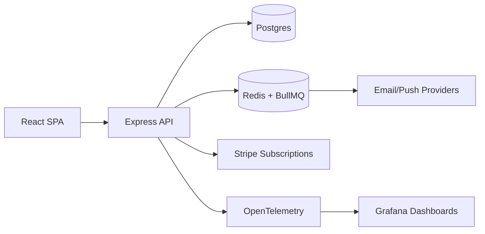

# Habit Tracker & Routine Coach SaaS

Consumer SaaS for individuals who want to build habits, stay accountable, and visualize progress with lightweight coaching and reminders.

## Status
Local single-user demo. Data resets when the backend restarts; it is not a production SaaS.

## Implemented
- Create, update and delete habits with daily, weekdays or weekly schedule labels
- Validated daily check-ins, deduplicated by habit and UTC date
- Habit totals, today's activity and seven-day check-in counts
- React UI backed by an Express API and an in-memory store
- Read-only sample plan catalog and a placeholder checkout response

## Planned integrations
Onboarding, recurrence enforcement, streak calculations, reminder delivery, coaching,
milestones, CSV export, authentication, PostgreSQL, Redis/BullMQ, Stripe and OpenTelemetry
are design targets, not implemented integrations. The architecture diagram below describes
that target. The demo does not send reminders or create a real payment session.

## Tech stack
- Backend: Node.js and Express
- Frontend: React and Vite
- Storage: process-local maps and arrays; dates use UTC

## Demo
- Live: TBD
- Video or GIF: TBD
- Screenshots:
  - `docs/screenshots/20251228_1805_Habit Tracker Dashboard_01.png`
  - `docs/screenshots/20251228_1805_Habit Tracker Habits_02.png`
  - `docs/screenshots/20251228_1805_Habit Tracker Insights_03.png`

## Quickstart (local)
Prereqs:
- Node.js 22.12+ (or a compatible newer release)

Run backend:
```bash
cd backend
npm ci
npm run dev
```

Run frontend:
```bash
cd ../frontend
npm ci
npm run dev
```

Open:
- Frontend: http://localhost:5173
- Backend: http://localhost:8085/api/health

## Target architecture


More details in `docs/architecture.md` and `docs/api.md`.

## Tests
```bash
# backend
cd backend
npm test

# frontend
cd ../frontend
npm test
```

## Security and limitations
The API has no authentication or multi-user isolation. Run this demonstration on a
trusted local machine. CORS defaults to the documented frontend at http://localhost:5173.
Set CORS_ORIGIN in the backend process environment to one exact HTTP(S) origin for a
different frontend; wildcards, opaque origins, credentials and URL paths are rejected
at startup. The example .env file is documentation and is not loaded automatically.
CORS controls which browser origins can read responses; it does not authenticate
clients or prevent direct requests. No production credentials are needed. The billing
URL is illustrative and must not be used for a real checkout. The backend restarts
with the sample habits.

## Roadmap / tradeoffs
- Add calendar integrations (Google/Apple)
- Add mobile push notifications via Firebase
- Add social accountability groups and challenges
- Tradeoff: speed of iteration vs. multi-tenant complexity
