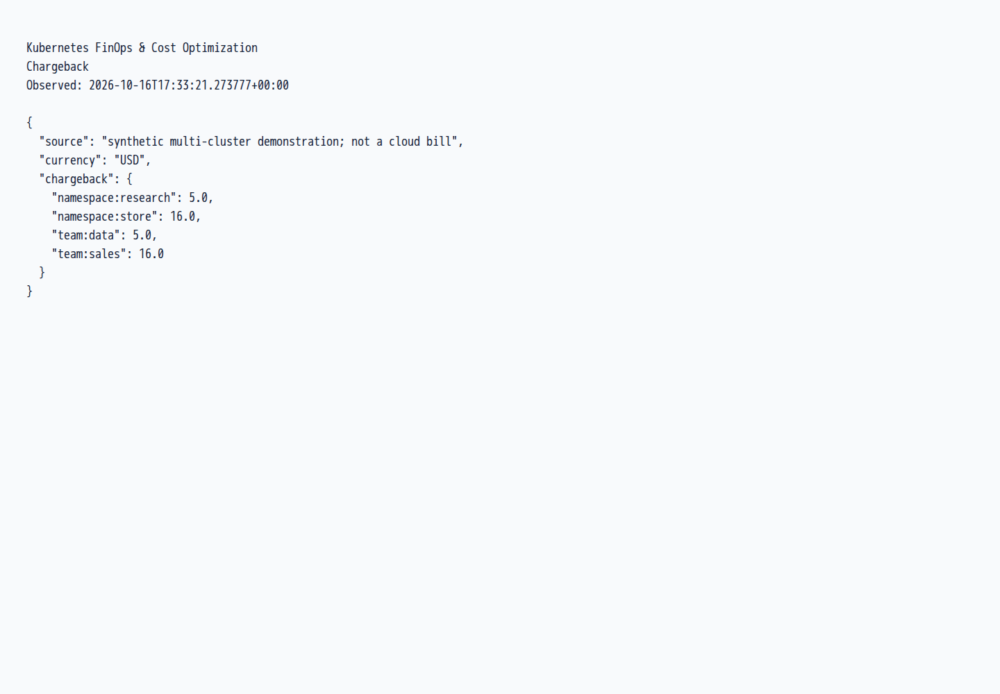
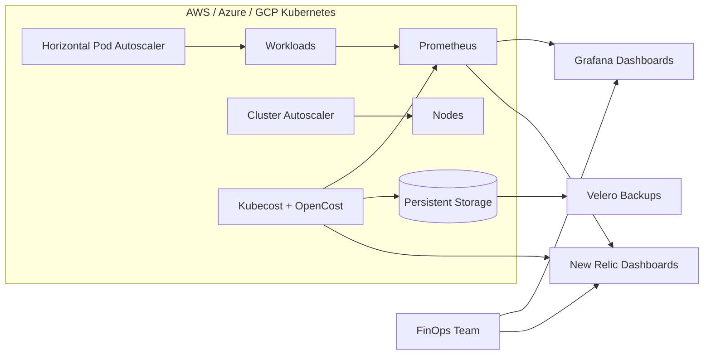

# Kubernetes FinOps & Cost Optimization

## Kubernetes cost visibility

Identify which workloads consume resources and evaluate where an optimization is worth testing.

**What I can deliver:** Allocation reports, anomaly and budget checks, right-sizing suggestions and guarded idle-workload shutdown/restoration.

**Skills demonstrated:** Kubernetes, OpenCost/Kubecost, Python, HPA, cost reporting.

[Browse the feature screenshots](screenshots/README.md) · [Services and project enquiries](../README.md#discuss-a-project)



*Actual demonstration capture. Reports use synthetic inputs and local estimates; no measured customer savings or live cloud bill is claimed.*

<details>
<summary>Technical documentation: features, architecture, setup and tests</summary>

## Features
- Kubecost/OpenCost deployed across AWS, Azure, and GCP for cost visibility and allocation.
- HPA and Cluster Autoscaler policies to right-size workloads and nodes.
- Prometheus scrape configuration with Grafana dashboards for cost, utilization, and efficiency.
- New Relic dashboards that merge cost and performance metrics.
- High availability with persistent storage and Velero backups for cost data.

## Tech stack (and why)
- Kubernetes (AWS/Azure/GCP): multi-cloud clusters for workload scheduling and cost allocation.
- Kubecost + OpenCost: cost visibility, allocation, and optimization signals.
- HPA + Cluster Autoscaler: right-sizing and node scaling.
- Prometheus + Grafana: metrics collection and cost/utilization dashboards.
- New Relic: unified cost and performance reporting.
- Helm: repeatable deployments across clusters.
- Velero: backups for persistent Kubecost data.
- MinIO (local demo): S3-compatible object storage for Velero backups.

## Demo
- Live: local demonstration; use the commands below.
- Screenshots:
  - `screenshots/20251228_1743_Kubernetes Cost Optimization_simple_compose_01kdjsz8vmf14a1mztyazge207.png`
  - `screenshots/20251228_1743_Kubernetes Cost Optimization_simple_compose_01kdjsz8vnew58xj469rs3v9eq.png`
  - `screenshots/20251228_1743_Kubernetes Cost Optimization_simple_compose_01kdjsz8vpe07ry5thp5tvxcnz.png`
  - `screenshots/20251228_1743_Kubernetes Cost Optimization_simple_compose_01kdjsz8vqe0jvvzn9s8k51d8a.png`


## Quickstart (local)
Prereqs:
- Docker
- kubectl
- Helm
- kind
- Make (optional, for one-command run)

Run:
```
cp .env.example .env  # optional
make dev
```

Configuration (optional):
- `KUBECOST_CLUSTER_ID`: cluster identifier used by Kubecost.
- `NEW_RELIC_LICENSE_KEY`: required for `make newrelic`.
- `NEW_RELIC_CLUSTER_NAME`: name shown in New Relic dashboards.
- `MINIO_ACCESS_KEY`/`MINIO_SECRET_KEY`: local MinIO credentials.
- `MINIO_BUCKET`: Velero backup bucket name.

Trigger autoscaling and cost signals:
```
make load
kubectl -n finops get hpa
```

Stop load:
```
make unload
```

Access:
```
make port-forward-kubecost
make port-forward-grafana
```

Grafana login: `admin / admin`

Backups:
```
make backup
kubectl -n velero get backups
```
Velero stores backups in the local MinIO bucket for the demo setup.

Optional New Relic integration:
```
make newrelic
```
Requires `NEW_RELIC_LICENSE_KEY` in `.env` or your shell environment.

Cluster Autoscaler (cloud):
```
helm repo add autoscaler https://kubernetes.github.io/autoscaler
helm upgrade --install cluster-autoscaler autoscaler/cluster-autoscaler -n kube-system \
  -f k8s/cluster-autoscaler/aws/values.yaml
# or: k8s/cluster-autoscaler/azure/values.yaml
# or: k8s/cluster-autoscaler/gcp/values.yaml
```
Update the placeholders in the values file for your cloud account (region, resource group, or node pool). Note: kind clusters do not scale nodes; validate Cluster Autoscaler in a cloud-backed cluster.

## Architecture


Each cluster runs Kubecost/OpenCost alongside Prometheus to collect cost and utilization metrics, while HPA and Cluster Autoscaler right-size workloads and nodes. Metrics and cost signals feed Grafana and New Relic dashboards, and Kubecost data persists to storage protected by Velero backups for resilient reporting.

## Tests
```
make test
```
Validates manifests with client-side dry-run.

## Security
Secrets: use `.env` (see `.env.example`). Store New Relic license keys in Kubernetes secrets, rotate MinIO demo credentials in real deployments, restrict Kubecost access with RBAC, and apply network policies between cost services and workloads. Enable encryption at rest for persistent volumes and lock down cloud IAM roles.

## Roadmap / tradeoffs
- Rightsizing recommendations use observed p95 plus 25% headroom, with explicit CPU/memory minimums. Cost anomalies compare daily cost with a median/MAD historical baseline.
- Chargeback aggregates by namespace and team across clusters; daily budget violations are included in the report.
- Idle remediation has an explicit workload opt-in, fresh complete telemetry, HPA exclusion, atomic concurrency checks and a recovery receipt. The default is a dry run; only `--apply` changes replicas.
- Tradeoff: richer telemetry improves visibility but adds runtime overhead and storage cost.

## Project structure
- `Makefile`: one-command setup and common workflows.
- `kind-config.yaml`: local multi-node kind cluster config.
- `k8s/namespace.yaml`: FinOps namespace.
- `k8s/metrics-server/values.yaml`: metrics-server Helm overrides for HPA.
- `k8s/kubecost/values.yaml`: Kubecost + Grafana Helm values.
- `k8s/minio/values.yaml`: MinIO object storage for Velero.
- `k8s/velero/values.yaml`: Velero Helm values (MinIO backend).
- `k8s/velero/backup.yaml`: sample backup definition.
- `k8s/workloads/`: demo workloads + HPA + load generator.
- `k8s/cluster-autoscaler/`: AWS/Azure/GCP values templates.

## Tags
monitoring, cost, kubernetes, autoscaling, grafana, prometheus, cost optimization, new relic, finops, kubecost

## Skills and tools
Tools and software: docker, kubernetes, grafana, helm, prometheus, new relic, hpa, cluster autoscaler, velero, kubecost, opencost.

Skills: kubernetes, devops.

## Validation without a cluster

`make test` uses kubeconform 0.8.0 to check every deployable manifest against
Kubernetes 1.36 and the pinned Velero Backup schema. Missing schemas and invalid
fields fail the check. Install kubeconform from its official release, or set
`KUBECONFORM` to an existing executable. Schema downloads need network access;
no kubeconfig, cluster creation, cloud credentials or deployment are needed.
The CRD schema registry commit is pinned in the Makefile and follows the
[custom resource workflow documented by kubeconform](https://github.com/yannh/kubeconform#customresourcedefinition-crd-support).

Schema validation does not exercise controllers, scheduling, metrics, backups or
restores. Verify those behaviors in the intended cluster before relying on a deployment.

## Reproducible local cluster

`make dev` pins the tested Helm chart versions and Kubernetes node image. It uses
this project's `.kube/config` and an explicit kind context, preserving the user's
default kubeconfig. For additional commands in this shell, use:

```bash
export KUBECONFIG="$PWD/.kube/config"
make status
make backup
kubectl -n velero get backups,podvolumebackups
```

Each `make backup` creates a new backup. A completed Kubernetes-object backup alone
does not prove that file contents were saved: inspect `podvolumebackups` and test a
restore into an isolated namespace. The kind storage class is annotated to create
`local` PVs, which Velero's filesystem backup supports. Existing `hostPath` PVs are
not converted by this setting; recreate only disposable demo data or migrate real
data separately.

The public MinIO images used by the old quickstart are no longer available. The
shared `../scripts/build-local-minio.sh` builds the official server/client commits
with Go 1.27.2 and loads them into this kind cluster. This is a local demonstration
of the archived upstream software, not a maintained production-storage service.
The first source build requires network access and takes longer than cached runs.

Remove this project's test cluster with `make destroy`. Cloud accounts, real
credentials and existing clusters are outside the local quickstart.

References: [MinIO source](https://github.com/minio/minio),
[local-path volume types](https://github.com/rancher/local-path-provisioner#volume-types),
[Velero filesystem backup](https://velero.io/docs/v1.18/file-system-backup/).

The local stack pins Kubecost chart 2.8.7, which includes the Prometheus/Grafana
architecture used here. Chart 2.9 is a migration agent and is not a compatible
replacement; Kubecost 3 requires a separate migration. Allow the chart's documented
25-minute collection window before judging allocation charts. Namespace costs are
estimates for this local cluster. `make port-forward-grafana` targets
`kubecost-grafana`; `make load` and `make unload` exercise the existing HPA.

## Complete local FinOps demonstration

Run from this project directory (Python 3.12+):

```bash
python scripts/finops.py report --html /tmp/finops-report.html
python scripts/test-finops.py
```

The supplied dataset explicitly represents synthetic AWS/Azure/GCP clusters. It
produces rightsizing recommendations, one cost anomaly, namespace/team chargeback
and budget alerts. Namespace and team totals are two views of the same costs;
do not add the two views together. Recommendations do not automatically change
requests and do not claim measured savings.

To import a running OpenCost instance through its local port-forward:

```bash
python scripts/finops.py collect --url http://127.0.0.1:9003 --output /tmp/allocation.json
python scripts/finops.py report --input /tmp/allocation.json
```

The importer preserves full-day windows and leaves idle/P95 metrics missing when
OpenCost supplies only averages. Supply independently measured `cpu_p95_m`,
`memory_p95_mib`, `idle_hours`, `requests_last_24h` and the exact Kubernetes
`context` to enable the corresponding recommendation or idle decision. Old demo
timestamps deliberately cannot authorize live scaling.

For a disposable Deployment, label it
`finops.demo/allow-idle-scale-down=true`. A snapshot no older than five minutes
must show a full idle day, zero requests and CPU p95 at most 5 millicores.
Select the cluster and workload explicitly:

```bash
python scripts/finops.py idle --input /tmp/fresh-allocation.json --context kind-finops-platform --namespace finops-demo --deployment idle-demo --receipt /tmp/idle-recovery.json
# Add --apply only for the intended disposable workload; otherwise this is a dry run.
python scripts/finops.py restore --context kind-finops-platform --receipt /tmp/idle-recovery.json --apply
```

An HPA blocks manual remediation. UID, resource version and replica preconditions
protect concurrent changes; the receipt is written before scaling and restores
only the same workload while it is still at zero replicas. Keep it until recovery
is verified. No scheduler or cloud resource is activated by generating a report.

API contract: [OpenCost allocation API](https://opencost.io/docs/integrations/api/).

## Verified screenshots

See the [per-function screenshot index](screenshots/README.md) for the existing local demonstration flows and their verification scope.

</details>
