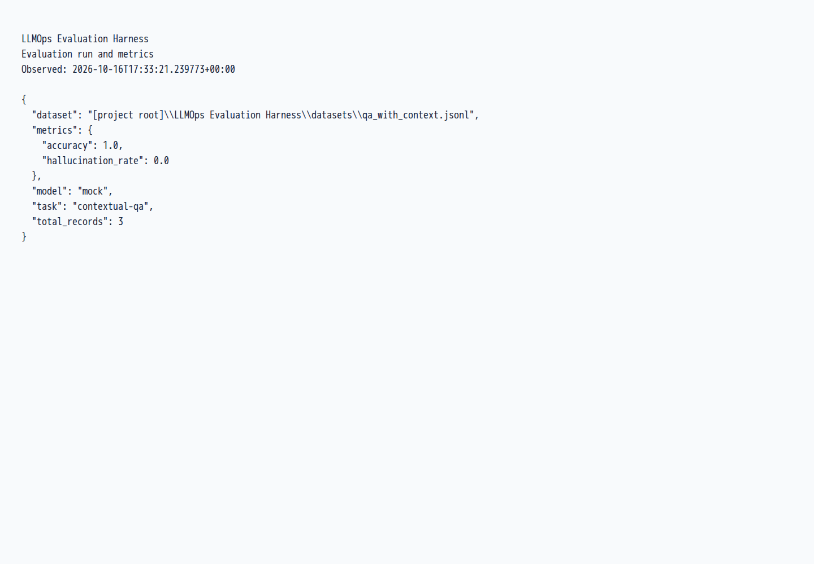
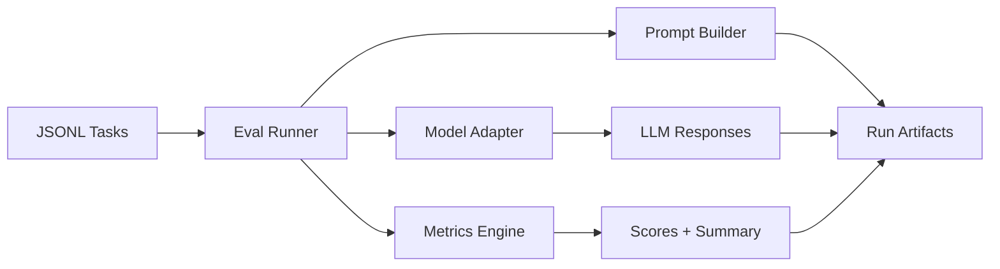

# LLMOps Evaluation Harness


<!-- LOCAL_WINDOWS_RUNTIME_20261004 -->
**This workstation — verification25 October2026.**
The project is under `H:\Projects\Portfolio`. [DevTools.ps1](DevTools.ps1) currently selects its Python3.15.0 environment;VSCode still has a3.14.8 selector. The Python3.15.1 replacement is prepared but awaits package security admission and full validation before either selector changes.

82 regression cases pass in normal and reverse order on the current Windows environment,including actual loopback HTTP,SQLite,CLI overrides,shipped examples and failure artifacts. Lint/format pass with the installed Ruff0.17.0;this is below the declared development minimum0.17.1 and is tracked for replacement. Remote model quality,Linux CI,a clean package build and the generic quickstart are not certified by these checks.

Exact local paths and recovery remain in the [Portfolio runbook](../PORTFOLIO_RUNBOOK.md#workstation-verification--4-october-2026). No old environment has been removed.
<!-- /LOCAL_WINDOWS_RUNTIME_20261004 -->

## Repeatable LLM evaluation

Compare changes to an AI feature against explicit examples and acceptance criteria.

**What I can deliver:** Dataset-based evaluations, response and tool-call checks, cached runs and persisted reports that can run in CI.

**Skills demonstrated:** Python, evaluation datasets, graders, SQLite, CI.

[Browse the feature screenshots](screenshots/README.md) · [Services and project enquiries](../README.md#discuss-a-project)



*Actual demonstration capture. Local mock and HTTP fixtures verify the harness; a target model must be evaluated separately on representative data.*

<details>
<summary>Technical documentation: features, architecture, setup and tests</summary>

## Demo
- Live: local demonstration; use the commands below.
- Interface: command-line reports; no browser UI is required.

## Why this exists
LLM behavior drifts, and manual review does not scale. This harness provides a lightweight, repeatable way to evaluate prompts and model responses, store results, and surface regressions in CI.

## Features
- JSONL-based evaluation tasks with prompt templates and per-task metrics
- Pluggable model adapters (mock + HTTP endpoint)
- Accuracy, F1, and hallucination-rate metrics with per-run summaries
- Run artifacts stored as JSONL for easy audit and diffing
- CI-ready workflow with lint, tests, and build checks

## Architecture


The harness loads task files, generates prompts, calls a model adapter, computes metrics, and writes request/response/score artifacts into a run directory for review and CI gating.

## Tech stack
- Backend: Python 3.10+, `requests`, JSONL storage
- Frontend: N/A
- Infra: Local filesystem artifacts, optional HTTP model endpoint
- CI: GitHub Actions (lint, tests, build)

## Quickstart (local)
Prereqs:
- Python 3.10+

Run:
```
python3 -m venv .venv
source .venv/bin/activate
pip install -r requirements-dev.txt
make dev
```

## Tests
```
make test
```

## Security
Secrets: use `.env` (see `.env.example`). Do not log prompts containing sensitive data. Store API keys in CI secrets and scope model endpoints to least privilege.

## Notes / limitations
- Metrics are heuristic and intended for regression detection, not absolute truth.
- Hallucination rate uses a simple context-overlap check and should be replaced with task-specific validators for production.

### Adding evaluation tasks

`--prompt-template` and `--metrics` override the corresponding values when `--task` is used. An explicitly empty prompt template is preserved. Dataset paths in task files are relative to the task file directory.
1. Create a JSONL file in `datasets/` with `id`, `input`, `expected`, and optional `context`.
2. Add a task config in `tasks/` pointing to the dataset, prompt template, and metrics list.
3. Run: `python -m eval_harness.cli --task tasks/<task>.json`

### CI integration
The workflow in `.github/workflows/llmops-eval-harness-ci.yml` runs `ruff`, `pytest`, and a package build. Add your task JSONL files and keep them small for fast CI.

## Task graders and response caching

The runner supports `regex`, `tool_calls`, and `semantic_similarity` in addition to the original metrics.
`regex` applies a full match against `metadata.pattern` (or `expected`). For tool tasks,
set `metadata.expected_tool_calls` to an ordered array of `{ "name": "lookup", "arguments": { "id": 3 } }`.
Responses use `{ "tool_calls": [...] }`; OpenAI function-call responses are also accepted.
Optional `metadata.tools` carries OpenAI tool schemas to the HTTP adapter. Tools are never executed.

Semantic grading calls an explicitly configured OpenAI-compatible embeddings endpoint with the response
and reference, then computes cosine similarity. Use `--embedding-endpoint <url> --embedding-model <model>`
and, if required, `EMBEDDING_API_KEY`. This metric requires an actual embedding model; tests use controlled
HTTP responses and do not certify any provider's semantic quality or account availability.

Enable persistent caching with `--cache runs/responses.sqlite --cache-namespace <model-config-version>`.
The namespace must identify the model/version, endpoint, generation settings and account; change it when
any of those change. Cache keys also include the complete prompt and record. Empty responses are valid;
failed generations are never cached or retried automatically. The SQLite file contains response text:
keep it private and delete that exact file to clear the cache. Concurrent misses can issue separate requests.

## Tradeoffs
- Tradeoff: simple metrics keep the harness portable but require careful task design.

## Decisions and rationale
- JSONL tasks keep data human-readable and easy to diff.
- Run artifacts are stored as JSONL for straightforward audit and downstream processing.

## Verified screenshots

See the [per-function screenshot index](screenshots/README.md) for the existing local demonstration flows and their verification scope.

</details>
