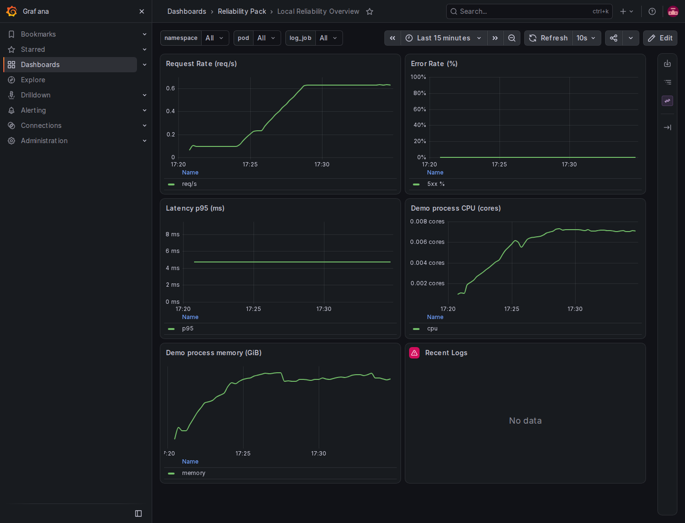
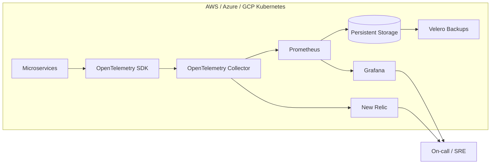

# Observability - New Relic & Prometheus

## Monitoring and incident diagnosis

Help a team see service errors, latency and resource use, then follow an alert to useful evidence.

**What I can deliver:** Instrumented services, metrics/logs/traces, Grafana dashboards and tested alert delivery, retry and deduplication.

**Skills demonstrated:** OpenTelemetry, Prometheus, Grafana, Mimir, logging, alerting.

[Browse the feature screenshots](screenshots/README.md) · [Services and project enquiries](../README.md#discuss-a-project)



*Actual demonstration capture. The working demonstration uses local services and a local notification receiver; external New Relic or paging accounts are not used.*

<details>
<summary>Technical documentation: features, architecture, setup and tests</summary>

## Features
- OpenTelemetry SDK + Collector instrumentation for metrics and traces
- Prometheus + Grafana stack with persistent volumes and HA-ready deployment patterns
- New Relic export for unified dashboards and alert policies across clouds
- Backup-ready monitoring data with Velero workflows
- SLO-oriented alerting for latency, errors, and saturation signals
- Reliability pack assets: Helm chart, dashboards, alert rules, and on-call runbooks
- Built-in telemetry generator for local validation of the pipeline
- Mimir 3.2 receives remote-write metrics labeled demo-a/demo-b, persists its WAL/blocks and configures 180-day retention.
- Blackbox Exporter 0.29 probes the actual API health status and response body.
- Alertmanager uses its native Slack and PagerDuty integrations against a persistent local protocol receiver, with retry, incident resolution and an inbox UI.

## Tech stack (and why)
- OpenTelemetry: vendor-neutral instrumentation and telemetry export.
- Prometheus: metrics ingestion, storage, and alerting.
- Grafana: dashboards for SLOs and service health.
- New Relic: unified observability and alerting across clouds.
- Kubernetes + Helm: repeatable deployments and HA-friendly config.
- Velero: backups for monitoring data.
- Docker: local dev stack and quick verification.

## Demo
- Live: local demonstration; use the commands below.
- Screenshots:
  - `screenshots/20251228_1746_Unified Cloud Observability_simple_compose_01kdjt55ncegvv90qnwvzbev87.png`
  - `screenshots/20251228_1746_Unified Cloud Observability_simple_compose_01kdjt55nde0kbfkfd985v68jc.png`
  - `screenshots/20251228_1746_Unified Cloud Observability_simple_compose_01kdjt55nee6b8yna3zqzdqnxa.png`
  - `screenshots/20251228_1746_Unified Cloud Observability_simple_compose_01kdjt55nffz8vwv00ghbnyvse.png`


## Reliability Pack
- Helm chart: `helm/reliability-pack` (ConfigMap dashboards + PrometheusRule alerts).
- Dashboards: `grafana/dashboards/reliability-overview.json`
- Alert rules: `prometheus/alert.rules.yml`
- Runbooks: `runbooks/`

## Quickstart (local)
Prereqs:
- Docker and Docker Compose
- Make (optional)

Run:
```
cp .env.example .env
make dev
# or: docker compose up --build
```

Demo telemetry:
- `telemetrygen` containers emit traces and metrics for `demo-service`.
- In Prometheus, validate the scrape with `up{job="otel-collector"}` and explore metrics labeled with `demo-service`.
- `log-generator` emits sample logs, and Promtail ships them to Loki for the logs panel.

Access:
- Prometheus: http://localhost:9090
- Grafana: http://localhost:3000 (admin / admin)
- Alertmanager: http://localhost:9093
- Loki: http://localhost:3100
- Mimir readiness: http://localhost:9009/ready
- Local paging inbox: http://localhost:8088

Send OTLP telemetry to:
- gRPC: `localhost:4317`
- HTTP: `localhost:4318`

New Relic (optional):
- Set `NEW_RELIC_LICENSE_KEY` in `.env`.
- Run `make newrelic` or set `OTEL_COLLECTOR_CONFIG=config-newrelic.yaml` before `make dev`.

## Dashboards
- Reliability Overview: CPU, memory, request rate, p95 latency, error rate, and recent logs.
- PromQL assumes Micrometer-style metrics (`http_server_requests_seconds_*`) and kube-state metrics; adjust labels/queries for your stack.

## Alerting
- Prometheus rules: `prometheus/alert.rules.yml` (service down, error rate, latency, saturation, telemetry, log ingestion).
- Alertmanager config: `alertmanager/alertmanager.yml` sends native Slack/PagerDuty payloads to `paging-demo` only. The local receiver validates the expected protocol, accepts only a synthetic PagerDuty routing key and never forwards messages externally.
- SyntheticCheckFailed fires after 30 seconds of a failed HTTP/body probe. The existing ServiceDown threshold remains two minutes.
- The inbox persists through restart. Its `POST /fail-next` endpoint accepts `{"kind":"pagerduty","count":1}` to exercise a recoverable 503; it is part of this isolated demo, not a production control endpoint.

## Helm chart
```
helm upgrade --install reliability-pack ./helm/reliability-pack
```
Notes:
- Requires `PrometheusRule` CRDs (kube-prometheus-stack) and a Grafana sidecar that loads ConfigMap dashboards.

## Runbooks
On-call guides live in `runbooks/` and map to each alert rule.

## Architecture


OpenTelemetry instruments each service and sends telemetry to a collector per cluster. Prometheus scrapes metrics and feeds Grafana dashboards backed by persistent storage, while New Relic receives metrics and traces for cross-cloud dashboards and alerts. Velero protects monitoring data for recovery and compliance.

## Tests
```
make test
```

## Security
Secrets: use `.env` (see `.env.example`). Store New Relic license keys in Kubernetes secrets or a vault, restrict Grafana access with SSO/RBAC, and apply network policies to limit collector ingress. Enable encryption at rest for Prometheus volumes and lock down cloud IAM for backups.

## Multi-cluster and retention demonstration

The primary and secondary Prometheus servers scrape separate API containers and remote-write to Mimir with distinct cluster labels. The Multi-cluster Demo dashboard queries Mimir for both sources and Prometheus for synthetic availability/duration. The verifier stops both writers, restarts Mimir and queries the previously recorded timestamp to prove persistent data survives without reingestion.

Mimir uses its documented local monolithic/filesystem mode with anonymous usage reporting disabled. Retention is configured to 4,320 hours (180 days); the short test verifies configuration and restart persistence, not 180 days of elapsed operation. Both simulated clusters share one host and this is not an HA or cross-region reliability claim.

Richer telemetry consumes disk and CPU even in a demonstration. All data lives in this stack's named volumes; the existing cleanup command resets only that stack.

## Notes / limitations
- The Docker stack runs on one host. Helm supplies reliability dashboard/rule assets for an existing Kubernetes monitoring stack; it does not itself create multiple clouds.
- Slack/PagerDuty protocol delivery is demonstrated locally. No real workspace, incident service, email or SMS is contacted. New Relic account-side behavior is outside the local demonstration.

## Tags
monitoring, tracing, kubernetes, grafana, prometheus, alertmanager, loki, observability, new relic, opentelemetry

## Skills and tools
Tools and software: docker, kubernetes, grafana, helm, prometheus, alertmanager, loki, new relic, velero, opentelemetry.

Skills: kubernetes, devops, ci/cd.

## Isolated functional demonstration

From the repository root:

```bash
python scripts/demo-check.py observability
# Retain a successful stack for inspection:
python scripts/demo-check.py observability --keep
```

The verifier uses fresh data and random loopback ports, prints the exact URLs and cleanup command, and fails if behavior is missing. It verifies real OTLP/HTTP metrics, Loki logs, provisioned dashboards, two Mimir cluster sources and persistence with both writers stopped. It stops only its own demo API, observes failed synthetic checks and ServiceDown, requires delivery through both local paging protocols after a controlled 503, then verifies resolution and inbox persistence after restart.

Official references: [Mimir local mode](https://grafana.com/docs/mimir/latest/get-started/), [Alertmanager integration configuration](https://prometheus.io/docs/alerting/latest/configuration/), [Blackbox Exporter 0.29](https://github.com/prometheus/blackbox_exporter/releases/tag/v0.29.0).

## Verified screenshots

See the [per-function screenshot index](screenshots/README.md) for the existing local demonstration flows and their verification scope.

</details>
