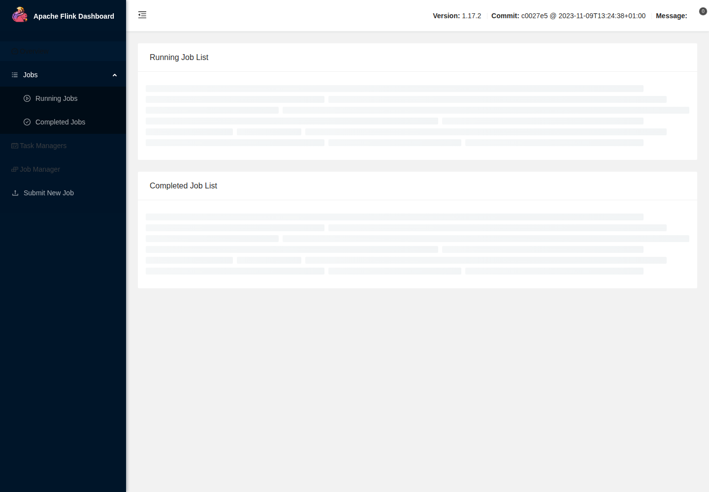
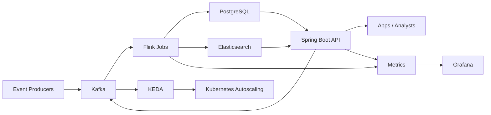

# Predictive Analytics Pipeline on Kubernetes


<!-- LOCAL_WINDOWS_RUNTIME_20261004 -->
**This workstation — Windows configuration checked 4 October 2026.**
This project is under `H:\Projects\Portfolio`. Use the existing explicit launchers below with DevTools PowerShell; they select the managed runtimes independently of a previously opened shell.
- [api/DevTools.ps1](api/DevTools.ps1): Java 25, Maven 3.10.0; Compile/Test.
- [flink/DevTools.ps1](flink/DevTools.ps1): Java 11, Maven 3.10.0; Compile/Test.

Exact local paths, recovery, dated test scope and Windows/Linux separation: [Portfolio runbook](../PORTFOLIO_RUNBOOK.md#workstation-verification--4-october-2026).
The generic Make/Docker examples below describe their own environments; they do not prove use of the Windows runtime. No application, container, external integration or test was started for this documentation check.
<!-- /LOCAL_WINDOWS_RUNTIME_20261004 -->

## Streaming data and analytics APIs

Process incoming events continuously and expose searchable results to an application or operations team.

**What I can deliver:** Kafka ingestion, Flink windows and scoring, persisted results, API access, monitoring and checkpoint recovery.

**Skills demonstrated:** Java, Kafka, Flink, Spring Boot, PostgreSQL, Elasticsearch, KEDA.

[Browse the feature screenshots](screenshots/README.md) · [Services and project enquiries](../README.md#discuss-a-project)



*Actual demonstration capture. The example uses synthetic sensor events; prediction quality on customer data needs its own evaluation.*

<details>
<summary>Technical documentation: features, architecture, setup and tests</summary>

## Features
- Kafka ingestion for durable event streams and backpressure handling
- Apache Flink stateful windows for real-time aggregations and prediction scoring
- PostgreSQL for relational history and Elasticsearch for search/analytics queries
- Spring Boot API for event ingestion and prediction access
- KEDA-ready design for event-driven autoscaling on Kubernetes
- Grafana dashboards for prediction and pipeline visibility

## Tech stack (and why)
- Apache Kafka: ingestion layer with durable streams and replay.
- Apache Flink: low-latency, stateful stream processing and windowed analytics.
- PostgreSQL: transactional storage for prediction history.
- Elasticsearch: fast search and analytics over predictions.
- Spring Boot (Java 25): REST API for ingestion and query access.
- KEDA + Kubernetes: autoscaling based on Kafka lag signals.
- Grafana: dashboards for prediction metrics and pipeline health.

## Demo
- Live: local demonstration; use the commands below.
- Video or GIF: `demo/pipeline-demo.gif`
- Screenshots: `demo/grafana-dashboard.png`, `demo/flink-ui.png`


## Quickstart (local)
Prereqs:
- Docker and Docker Compose
- Java 25+ (optional, only if running services outside Docker)

Run:
```
make dev
```

Or:
```
docker compose up --build
```

Generate sample events (IoT-style sensor readings):
```
./demo/send-events.sh
```

Verify output:
```
curl "http://localhost:8082/api/predictions?limit=5"
```

Search predictions in Elasticsearch:
```
curl "http://localhost:8082/api/predictions/search?q=sensor&limit=5"
```

Open dashboards (first results appear after the first 30-second window):
- Flink UI: http://localhost:8081
- Grafana: http://localhost:3001 (admin / admin)

Local ports:
- API: http://localhost:8082
- Kafka: localhost:9094
- PostgreSQL: localhost:5433
- Elasticsearch: http://localhost:9200

Configuration:
- Environment variables are used for brokers, topics, and data stores (see `.env.example`).
- Docker Compose wires defaults for local development.

## Architecture


Events are published to Kafka, Flink computes tumbling-window aggregations and prediction scores, and results are written to PostgreSQL and Elasticsearch. The Spring Boot API exposes predictions and provides a simple event ingestion endpoint. Grafana dashboards visualize PostgreSQL data, while Elasticsearch enables fast ad-hoc queries.

### Project structure
- `api/`: Spring Boot ingestion and query API
- `flink/`: Flink streaming job (ETL + scoring)
- `infra/`: database init and schema
- `k8s/`: Kubernetes manifests and KEDA scaling
- `grafana/`: provisioning + dashboards
- `demo/`: screenshots and demo assets
- `docs/`: OpenAPI spec and usage notes
- `docker-compose.yml`: local stack

### Data schema
PostgreSQL schema is defined in `infra/postgres/init.sql`:
```sql
CREATE TABLE predictions (
  id SERIAL PRIMARY KEY,
  event_type TEXT NOT NULL,
  window_start TIMESTAMP NOT NULL,
  window_end TIMESTAMP NOT NULL,
  event_count BIGINT NOT NULL,
  avg_value DOUBLE PRECISION NOT NULL,
  prediction_score DOUBLE PRECISION NOT NULL,
  created_at TIMESTAMP NOT NULL DEFAULT NOW()
);
```

Elasticsearch index `predictions` stores JSON documents with `event_type`, `window_start`, `window_end`, `event_count`, `avg_value`, `prediction_score`, and `generated_at`.

### Processing notes
- Both producer and Flink validate the bundled JSON Schema. Invalid Kafka records go to `events.invalid`; Flink exposes accepted/rejected counters. The API rejects malformed requests before publication.
- The fitted univariate Gaussian model scores 30-second window averages as absolute z-scores. A score >= 3 is anomalous. `ml/training.csv` contains 20 synthetic normal windows; `ml/validation.csv` has eight held-out windows. `python ml/train.py --check` reproduces the model and checks all eight labels. This demonstrates anomaly detection, not calibrated real-world accuracy.

## Tests
```
make test
```

Or:
```
mvn -f api/pom.xml verify
mvn -f flink/pom.xml test
```

## Security
Secrets: use `.env` (see `.env.example`). Demo credentials are for local use only. The demo API is unauthenticated; add JWT/OAuth and network policies for production. Use RBAC and namespace isolation for Kubernetes, and restrict Kafka/PostgreSQL/Elasticsearch access to internal services. Data used in demos is synthetic.

## Demonstrative roadmap
- A fitted anomaly model, reproducible training inputs and held-out checks replace the placeholder score.
- Confluent Schema Registry registers the exact JSON contract with backward compatibility enforcement. Both services validate it locally; the registry being available alone is not validation.
- `mvn -f api/pom.xml verify` runs real Kafka/PostgreSQL Testcontainers integration. Missing Docker fails rather than skipping the test.
- `python scripts/kind-demo.py --cluster <disposable-kind-cluster>` builds and loads the images, provisions a fresh namespace and checks Kafka lag scaling, Flink reactive parallelism, checkpoint recovery and new predictions. See [Kubernetes guide](k8s/README.md).
- OTLP producer spans measure each acknowledged or failed Kafka send. Compose and Kubernetes use a local OpenTelemetry Collector.
- PostgreSQL and Elasticsearch use deterministic window keys, making checkpoint replay idempotent at both sinks. They are separate sinks, without a distributed transaction; temporary divergence during an outage is observable.
- Tradeoff: dual storage improves query flexibility at the cost of operational overhead. The local Gaussian baseline is intentionally small and domain-specific.

## Performance
Use `python perf/benchmark.py --url http://127.0.0.1:8082` for a bounded local benchmark (100 requests, four workers by default). The JSON output records wall-clock time, mean/p95 latency, throughput and failures. `perf/k6/pipeline-load.js` remains available for a paced 30-second workload.

Observed on an isolated Docker Desktop demo, 16 October 2026: 100/100 requests acknowledged, zero errors, 0.576 seconds, 173.47 requests/second, mean 22.90 ms and p95 30.96 ms. This measures ingestion acknowledgement on one host, not sustained end-to-end production capacity. The functional test separately compares completed PostgreSQL and Elasticsearch windows and verifies traces and rejected records.

## API
- OpenAPI: `docs/openapi.yaml`
- Usage examples: `docs/api.md`

## Kubernetes
- Deployment guide: `k8s/README.md`

## Skills and Deliverables
- Apache Kafka
- Kubernetes
- PostgreSQL
- Apache Flink
- Grafana

Role: Java Engineer.

## Isolated functional demonstration

From the repository root:

```bash
python scripts/demo-check.py predictive
# Retain a successful stack for inspection:
python scripts/demo-check.py predictive --keep
```

The verifier uses fresh data and random loopback ports, prints the exact URLs and
cleanup command, and fails if the demonstrated behavior is missing. The check streams 200 events across event-time windows and compares PostgreSQL results with Elasticsearch. `demo/send-events.sh` uses the same longer stream; the final incomplete window needs newer events, not just wall-clock waiting.

## Verified screenshots

See the [per-function screenshot index](screenshots/README.md) for the existing local demonstration flows and their verification scope.

</details>
