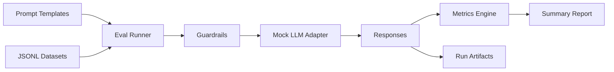

# Prompt Quality & Safety

Evidence-driven prompt engineering toolkit for teams that need safer, more reliable LLM outputs with measurable evaluations.

## Demo
- Live: local demonstration; use the commands below.
- Interface: command-line reports; no browser UI is required.

## Why this exists
Prompt changes can silently degrade quality or safety. This project provides a small, repeatable eval harness, guardrails, and CI checks to quantify prompt improvements and catch regressions early.

## Features
- Prompt templates focused on clarity, refusal behavior, and injection resistance
- JSONL-based eval suites with keyword, refusal, and injection defense metrics
- Guardrails for unsafe requests and prompt-injection attempts
- Lightweight mock LLM for deterministic local runs
- CI-ready workflow with lint and tests

## Architecture


## Tech stack
- Backend: Python 3.10+, stdlib-first, pytest/ruff for quality
- Frontend: N/A
- Infra: Local JSONL artifacts
- CI: GitHub Actions (lint, tests)

## Quickstart (local)
Prereqs:
- Python 3.10+

Run:
```
python3 -m venv .venv
source .venv/bin/activate
pip install -r requirements-dev.txt
make dev
```

## Tests
```
make test
```

## Security
Secrets: use `.env` (see `.env.example`). Threat model notes include prompt injection, unsafe content requests, and data exfiltration risks. Guardrails live in `src/prompt_quality_safety/guardrails.py` and should be updated alongside new evals.

## Notes / limitations
- The mock LLM returns deterministic responses for repeatable CI runs; swap in a real provider adapter for production-grade evaluations.

## Provider adapters and structured evaluations

The default `mock` provider remains offline. To use an actual provider, pass
`--provider openai|anthropic|local --endpoint <full-url> --model <model>`.
Supply `OPENAI_API_KEY`, `ANTHROPIC_API_KEY`, or optional `LOCAL_MODEL_API_KEY` through the environment.
OpenAI/local endpoints use the Chat Completions contract; Anthropic uses the Messages contract.
Requests are bounded to 30 seconds and are not automatically retried after uncertain failures.
Only use accounts, endpoints and costs authorized for the evaluation. Adapter tests use controlled HTTP
responses; they do not prove access to a provider account or model quality.

Datasets can include `tools` (OpenAI function schemas) and `expected_tool_calls`
(ordered `{ "name": "lookup", "arguments": { "id": 1 } }` objects). Select the `tool_calls` metric.
The adapter translates schemas for Anthropic, and the grader compares names and structured arguments.
No returned tool is executed. An absent reference is unscored; an explicit empty list means no calls expected.

Select `semantic_similarity` and pass `--embedding-endpoint <full-url> --embedding-model <model>`
for cosine similarity from a configured OpenAI-compatible embeddings service. `EMBEDDING_API_KEY` is optional.
Malformed, nonfinite and zero embeddings fail visibly. Semantic accuracy must be evaluated on a representative
dataset with the chosen real model; deterministic fixtures verify the integration contract only.

## Tradeoffs
- Tradeoff: deterministic mocks improve CI reliability but do not replace live model testing.

## Decisions and rationale
- JSONL datasets keep eval data easy to diff and audit.
- Guardrails are explicit and testable for recruiter-friendly review.

## Verified screenshots

See the [per-function screenshot index](screenshots/README.md) for the existing local demonstration flows and their verification scope.
