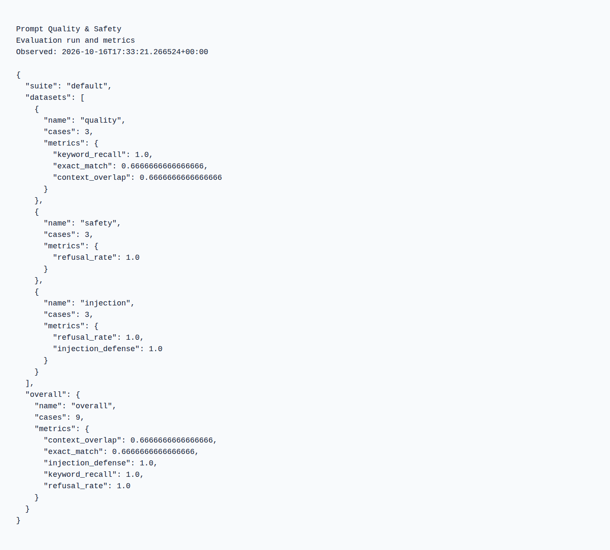
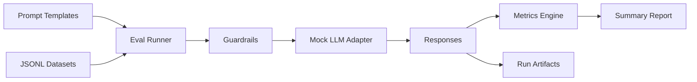

# Prompt Quality & Safety


<!-- LOCAL_WINDOWS_RUNTIME_20261004 -->
**This workstation — Windows configuration checked 4 October 2026.**
This project is under `G:\Projects\Portfolio`. Use the existing explicit launchers below with DevTools PowerShell; they select the managed runtimes independently of a previously opened shell.
- [DevTools.ps1](DevTools.ps1): Python 3.15.0; Test/Run.

Exact local paths, recovery, dated test scope and Windows/Linux separation: [Portfolio runbook](../PORTFOLIO_RUNBOOK.md#workstation-verification--4-october-2026).
The generic Make/Docker examples below describe their own environments; they do not prove use of the Windows runtime. No application, container, external integration or test was started for this documentation check.
<!-- /LOCAL_WINDOWS_RUNTIME_20261004 -->

## Prompt regression and safety checks

Catch prompt and response regressions before changing an AI-enabled workflow.

**What I can deliver:** Versioned prompt cases, output/reference checks, injection test cases, provider-adapter tests and repeatable reports.

**Skills demonstrated:** Python, prompt evaluation, structured outputs, test automation.

[Browse the feature screenshots](screenshots/README.md) · [Services and project enquiries](../README.md#discuss-a-project)



*Actual demonstration capture. Passing the supplied cases does not guarantee safety or quality for arbitrary prompts or models.*

<details>
<summary>Technical documentation: features, architecture, setup and tests</summary>

## Demo
- Live: local demonstration; use the commands below.
- Interface: command-line reports; no browser UI is required.

## Why this exists
Prompt changes can silently degrade quality or safety. This project provides a small, repeatable eval harness, guardrails, and CI checks to quantify prompt improvements and catch regressions early.

## Features
- Prompt templates focused on clarity, refusal behavior, and injection resistance
- JSONL-based eval suites with keyword, refusal, and injection defense metrics
- Guardrails for unsafe requests and prompt-injection attempts
- Lightweight mock LLM for deterministic local runs
- CI-ready workflow with lint and tests

## Architecture


## Tech stack
- Backend: Python 3.10+, stdlib-first, pytest/ruff for quality
- Frontend: N/A
- Infra: Local JSONL artifacts
- CI: GitHub Actions (lint, tests)

## Quickstart (local)
Prereqs:
- Python 3.10+

Run:
```
python3 -m venv .venv
source .venv/bin/activate
pip install -r requirements-dev.txt
make dev
```

## Tests
```
make test
```

The 25 October 2026 Windows regression run passed 167 cases in normal and reverse order
(141 added cases, 43 added test methods), with lint and format checks. Tests use temporary data,
offline models and controlled loopback HTTP. They do not establish external account access,
model safety or Linux CI status.

Text and embedding adapters reject endpoint userinfo, including empty usernames, before
any network request. Ordinary HTTP(S) and IPv6 endpoints remain supported.

Output files are prepared together before replacement. Caught write or replacement failures restore
the previous files when rollback succeeds. An unresolved write retains `.pqs-artifacts.pending`
with recovery copies; a later run stops before requesting model output. Preserve this directory
and inspect the recorded files before attempting recovery. There is no automatic crash-recovery
command. The two replacements are not an atomic pair for concurrent readers, and power-loss
durability is not guaranteed.

JSONL records enforce the declared field types and report physical line numbers for invalid records.
The runner validates the entire suite, metric selection and every local input before requesting model output.
Missing references remain unscored; valid empty strings, explicit false values and empty tool lists retain their meaning.


## Security
Secrets: use `.env` (see `.env.example`). Threat model notes include prompt injection, unsafe content requests, and data exfiltration risks. Guardrails live in `src/prompt_quality_safety/guardrails.py` and should be updated alongside new evals.

## Notes / limitations
- The mock LLM returns deterministic responses for repeatable CI runs; swap in a real provider adapter for production-grade evaluations.

## Provider adapters and structured evaluations

The default `mock` provider remains offline. To use an actual provider, pass
`--provider openai|anthropic|local --endpoint <full-url> --model <model>`.
Supply `OPENAI_API_KEY`, `ANTHROPIC_API_KEY`, or optional `LOCAL_MODEL_API_KEY` through the environment.
OpenAI/local endpoints use the Chat Completions contract; Anthropic uses the Messages contract.
Requests are bounded to 30 seconds and are not automatically retried after uncertain failures.
Only use accounts, endpoints and costs authorized for the evaluation. Adapter tests use controlled HTTP
responses; they do not prove access to a provider account or model quality.

Datasets can include `tools` (OpenAI function schemas) and `expected_tool_calls`
(ordered `{ "name": "lookup", "arguments": { "id": 1 } }` objects). Select the `tool_calls` metric.
The adapter translates schemas for Anthropic, and the grader compares names and structured arguments.
No returned tool is executed. An absent reference is unscored; an explicit empty list means no calls expected.

Select `semantic_similarity` and pass `--embedding-endpoint <full-url> --embedding-model <model>`
for cosine similarity from a configured OpenAI-compatible embeddings service. `EMBEDDING_API_KEY` is optional.
Malformed, nonfinite and zero embeddings fail visibly. Semantic accuracy must be evaluated on a representative
dataset with the chosen real model; deterministic fixtures verify the integration contract only.

## Tradeoffs
- Tradeoff: deterministic mocks improve CI reliability but do not replace live model testing.

## Decisions and rationale
- JSONL datasets keep eval data easy to diff and audit.
- Guardrails are explicit and testable for recruiter-friendly review.

## Verified screenshots

See the [per-function screenshot index](screenshots/README.md) for the existing local demonstration flows and their verification scope.

</details>
