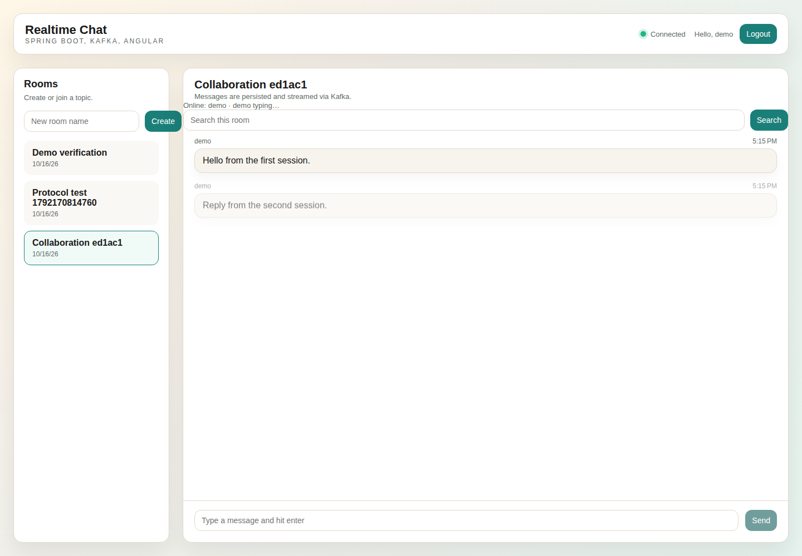
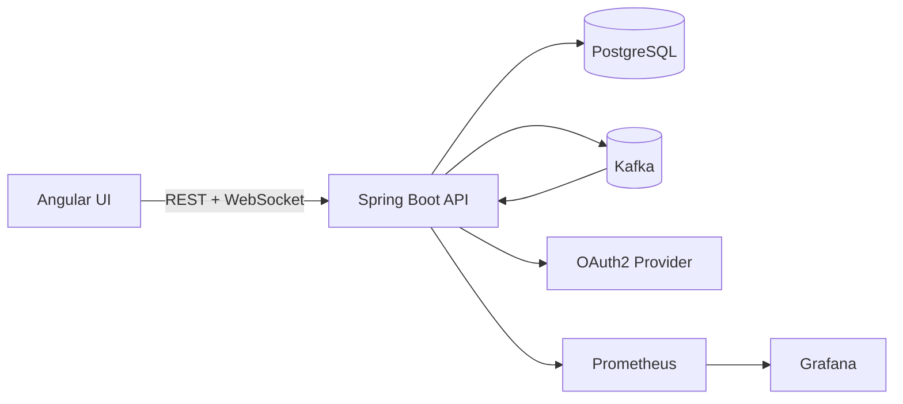
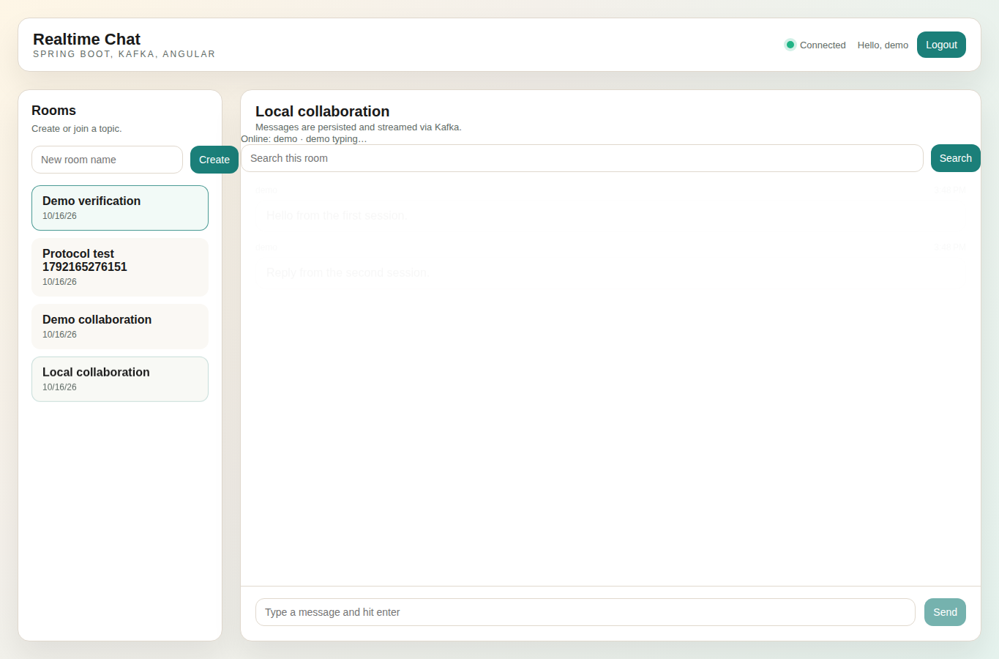

# Real-Time Chat & Collaboration Platform


<!-- LOCAL_WINDOWS_RUNTIME_20261004 -->
**This workstation — Windows configuration checked 4 October 2026.**
This project is under `G:\Projects\Portfolio`. Use the existing explicit launchers below with DevTools PowerShell; they select the managed runtimes independently of a previously opened shell.
- [backend/DevTools.ps1](backend/DevTools.ps1): Java 25, Maven 3.10.0; Compile/Test.
The Angular frontend uses Node 26.11.1 and its separate `.devtools/Windows/Angular-22.2.1` environment. Its existing maintenance entry `G:\DevTools\Update-RealTimeChatEnvironment.ps1 -Offline -Build` reinstalls dependencies before building; it is not a read-only check or a server launcher.

Exact local paths, recovery, dated test scope and Windows/Linux separation: [Portfolio runbook](../PORTFOLIO_RUNBOOK.md#workstation-verification--4-october-2026).
The generic Make/Docker examples below describe their own environments; they do not prove use of the Windows runtime. No application, container, external integration or test was started for this documentation check.
<!-- /LOCAL_WINDOWS_RUNTIME_20261004 -->

## Real-time collaboration features

Add live conversations and useful presence indicators while retaining searchable message history.

**What I can deliver:** Room-based chat, two-way message delivery, typing/presence, rate limits and persisted history with recovery checks.

**Skills demonstrated:** Java, Spring Boot, WebSocket/STOMP, Angular, Kafka, PostgreSQL, Redis.

[Browse the feature screenshots](screenshots/README.md) · [Services and project enquiries](../README.md#discuss-a-project)



*Actual demonstration capture. The demonstration uses local identities and services; an external OAuth provider is configured separately.*

<details>
<summary>Technical documentation: features, architecture, setup and tests</summary>

## Features
- WebSocket/STOMP messaging with room subscriptions
- Kafka-backed fan-out for horizontal scaling
- PostgreSQL persistence for room and message history
- Room-scoped message search, Redis presence and expiring typing indicators
- Redis rate limits and durable, deduplicated message submission
- OAuth2 (GitHub) login with session-based access
- Prometheus metrics and Grafana dashboards
- Docker Compose for local dev and Terraform for Kubernetes deploys

## Tech stack (and why)
- Backend: Spring Boot for WebSocket/STOMP, REST APIs, and OAuth2 security.
- Frontend: Angular + RxJS for reactive real-time UI.
- Eventing: Kafka for scalable message fan-out.
- Data: PostgreSQL for durable history and room metadata.
- Observability: Prometheus + Grafana for metrics and dashboards.
- Infra: Docker Compose for local, Terraform for Kubernetes.

## Demo
- Live: local demonstration; use the commands below.
- Screenshots:
  - `screenshots/20251228_1749_Collaboration Platform Overview_simple_compose_01kdjtact1eb99x46tmvcat4wr.png`
  - `screenshots/20251228_1749_Collaboration Platform Overview_simple_compose_01kdjtact2e4wv1gne7zp7nser.png`
  - `screenshots/20251228_1749_Collaboration Platform Overview_simple_compose_01kdjtact3fvaa1wr0wz4zh06e.png`
  - `screenshots/20251228_1749_Collaboration Platform Overview_simple_compose_01kdjtact4eh9a76psm08a3t61.png`


## Quickstart (local)
Prereqs:
- Docker and Docker Compose
- GitHub OAuth app (optional unless using demo auth)

Run:
```
docker compose -f infra/docker-compose.yml up --build
```
Or:
```
make dev
```

Auth options:
- OAuth2: set `GITHUB_CLIENT_ID` and `GITHUB_CLIENT_SECRET` in `.env` and use callback `http://localhost:4201/login/oauth2/code/github`.
- Demo mode: set `DEMO_AUTH=true` in `.env` to bypass OAuth locally.

Open:
- Frontend: http://localhost:4201
- Backend: http://localhost:8081

## Architecture


Detailed flow and scaling notes in `docs/architecture.md`.

## Tests
```
mvn -f backend/pom.xml test
```

## Security
Secrets: use `.env` (see `.env.example`). OAuth2 session cookies protect REST and WebSocket access. Demo auth is for local development only.

State-changing REST requests require a session CSRF token in both OAuth and demo
modes. The frontend fetches it from GET /api/csrf immediately before creating a
room. SockJS transport endpoints are exempt only from the HTTP token check;
Spring Security validates the session token in the STOMP CONNECT headers instead.
Every connection or reconnect obtains a fresh token. Browser origins remain
restricted, and OAuth mode requires authentication for the WebSocket handshake
and allowed room destinations. Client sends to broker topics or other destinations
are rejected. Logout uses Spring's CSRF-protected confirmation page.


## Notes / limitations
- Status: MVP; OAuth2 is required unless demo auth is enabled.
- Kafka fan-out is configured for local single-broker usage.

## Roadmap / tradeoffs
- Presence and typing use Redis hashes with expiry and Pub/Sub updates across backend instances. Clients refresh presence every 15 seconds; disconnected members expire after 45 seconds and typing after 3 seconds. Explicit leave/disconnect removes the participant immediately when Redis is available.
- Search is case-insensitive and confined to the selected room, with a maximum of 100 results. All signed-in users currently have access to all rooms; private-room membership is not part of this application.
- Message submissions are limited to 60 per minute per authenticated identity (per session in explicit demo mode). Presence updates are limited to 120 per minute per session. Redis failure rejects submission rather than silently disabling limits.
- PostgreSQL saves a pending message before Kafka publication. A worker retries failed publication; client request IDs prevent duplicate history after reconnect. Delivery is at least once and the UI deduplicates event IDs. A receipt confirms durable storage, not that every recipient has read the message. Pending client submissions survive transport reconnect in the open page; closing an unacknowledged page does not persist its unsent draft.
- Tradeoff: session-based auth keeps the UI simple but complicates API use from external clients.
- Use a distinct Kafka consumer group per backend instance, the shared PostgreSQL/Redis services, and sticky sessions at the ingress for OAuth/SockJS. The default group includes the container hostname. Independent replicas may retry the same pending publication; event IDs remain stable.

## Isolated functional demonstration

From the repository root:

```bash
npm ci --prefix "Real-Time Chat & Collaboration Platform/frontend"
python scripts/demo-check.py chat
# Retain a successful stack for inspection:
python scripts/demo-check.py chat --keep
```

The verifier uses fresh data and random loopback ports, prints the exact URLs and
cleanup command, and fails if the demonstrated behavior is missing. It requires Node.js 26 and checks two real STOMP sessions, presence, typing, search, duplicate requests, rate limits and PostgreSQL-backed delivery through a Kafka outage. With `--keep`, open the printed frontend URL in two tabs for a visual walkthrough. Demo authentication is enabled only in this isolated stack.

## Captured functional demonstration

Two-session conversation and persisted messages. Captured from the running local application on 16 October 2026.



## Verified screenshots

See the [per-function screenshot index](screenshots/README.md) for the existing local demonstration flows and their verification scope.

</details>
