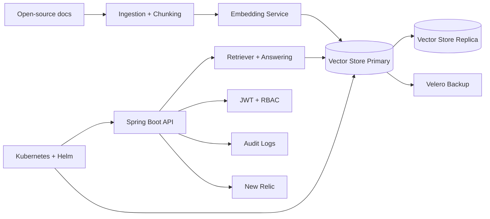

# Secure RAG Service & Knowledge API

Secure retrieval-augmented generation (RAG) microservice for platform and knowledge teams that need question answering over open-source documentation with high availability.

## Features
- Ingests open-source documentation, chunks content, and embeds it into a replicated vector store.
- Spring Boot API for retrieval and question answering.
- JWT-protected endpoints with role-based access control (RBAC).
- Audit logging for access and inference activity.
- Three-peer local vector replication, node failure/recovery and an isolated snapshot restore demonstration.
- New Relic monitoring and Helm-based deployment to multi-cloud Kubernetes clusters.

## Tech stack (and why)
- Spring Boot (Java 25): REST API, dependency injection, and production-ready runtime.
- Spring Security + JWT: authentication, authorization, and RBAC enforcement.
- Qdrant: persistent vector storage; the resilience demonstration runs three independent local peers.
- LangChain4j: RAG orchestration and retrieval workflows in Java.
- Kubernetes + Helm: repeatable, multi-cloud deployments and upgrades (chart in `helm/secure-rag`).
- Velero: backup and restore for stateful vector data.
- New Relic: traces, metrics, and logs for performance and reliability.

## Demo
- Live: local demonstration; use the commands below.
- Screenshots:
  - `demo/rag-overview.svg`
  - `demo/rag-query.svg`


## Quickstart (local)
Prereqs:
- Java 25+
- Docker and Docker Compose
- Python 3 (for the demo script)

Run:
```
docker compose up --build
./scripts/demo.sh
```

Makefile shortcuts:
```
make dev
make demo
```

Local API: `http://localhost:8090`

Config:
- `cp .env.example .env` and adjust secrets for local runs.
- For non-Docker runs, set `QDRANT_URL=http://localhost:6333`.

## Architecture


Docs are ingested, chunked, embedded and stored in Qdrant. The API applies JWT/RBAC and records access events. The default Compose stack has one store; the separate resilience demonstration exercises replication and native snapshots. Helm provides API replicas and HPA. Cloud telemetry and multi-zone placement are deployment configuration, not observed cloud availability.

## RAG benefits
- Fresh and domain-specific answers without retraining: new docs can be ingested and queried immediately.
- Source-aware responses: retrieved passages can be surfaced as citations to improve trust and debugging.
- Cost-effective iteration: embeddings + retrieval scale better than frequent model retraining.

## Tests
```
mvn -f api/pom.xml test
```

Or:
```
make test
```

## Security
Secrets: use `.env` (see `.env.example`). JWT-based authentication and RBAC restrict access to endpoints; the dev token endpoint is gated by `X-Dev-Key` and should be disabled in production. Threat model basics in `docs/threat-model.md` cover prompt injection and data exfiltration risks. Use Kubernetes RBAC, network policies, and least-privilege service accounts for production.

## Notes / limitations
- Local mode uses deterministic hash-based embeddings and a lightweight mock LLM to stay self-contained; swap in LangChain4j-backed embeddings/LLMs for production quality.

## Hybrid retrieval and model providers

Queries fuse vector candidates with BM25 lexical ranks using reciprocal-rank fusion. The lexical corpus is
read from Qdrant, so restarting the API preserves retrieval. The local BM25 implementation supports at most
10,000 chunks and fails visibly above that size; use a scalable lexical index before increasing the corpus.
Ranking is deterministic and does not claim a learned cross-encoder reranker.

Embedding requests are batched in groups of 64 and cached in a bounded 512-entry in-process cache.
Retrieval results have a five-second TTL and a 128-entry bound. Ingesting in this API instance invalidates
its retrieval cache. Other replicas can retain results until their TTL expires. Answers are generated afresh.
Reingestion with the same `documentId` replaces stable chunk IDs and removes stale tail chunks. Qdrant upsert
and cleanup are separate operations; retry the same document after a failed write. There is no cross-replica
atomic document replacement guarantee.

The default `RAG_PROVIDER=local` retains hash embeddings and the labeled mock answer. An actual
LangChain4j OpenAI-compatible provider is available through `RAG_PROVIDER=openai`,
`RAG_PROVIDER_BASE_URL`, `RAG_PROVIDER_API_KEY`, `RAG_EMBEDDING_MODEL`, and `RAG_CHAT_MODEL`.
Set `RAG_VECTOR_SIZE` to the embedding model dimension and use a separate `QDRANT_COLLECTION` for each
embedding model/version. Do not mix vectors from different models in an existing collection.
The provider has a 30-second request timeout and no automatic retries. It receives only the question and
retrieved text, with reference text separated from the system instructions. Use an authorized account and
budget; no live provider request is part of the default demo.

`HybridRetrievalTest` covers lexical/vector regression cases, cache invalidation, batching and stable IDs.
`ProviderModelsTest` uses a local HTTP fixture to exercise the real SDK's requests and injection instruction
boundaries. These tests prove transport/structure, not a model's resistance to prompt injection. Evaluate
the chosen real model on representative and adversarial documents before exposing it to untrusted users.

## Reproducible evaluation

`eval/dataset.json` contains six synthetic documents and seven questions, including instruction-injection examples. `scripts/evaluate.py` ingests them into an explicitly selected isolated loopback API, then reports document recall, precision, reciprocal rank, latency and exact adversarial target failures. Set `RAG_EVAL_ADMIN_TOKEN` and `RAG_EVAL_USER_TOKEN` in the environment; tokens are never written to the report. The default local provider makes no external model calls.

```sh
python scripts/evaluate.py --url http://127.0.0.1:8090 --output evaluation.json
python scripts/test_evaluate.py
```

The repository's `python scripts/demo-check.py rag` runs this evaluation against its fresh Qdrant-backed stack automatically. PASS requires every case's relevant document to be retrieved and no exact adversarial target output. Quoted instructions in labeled reference output are not counted as instruction following. These narrow checks do not establish semantic answer quality or general injection resistance; the report states that limit explicitly.

## Tradeoffs
- Tradeoff: multi-AZ replication increases cost and operational overhead in exchange for availability.

## Tags
ai, security, docker, knowledge base, spring boot, jwt, kubernetes, helm, rag, new relic, qdrant, vector store

## Skills and tools
Tools and software: ai, security, docker, knowledge base, spring boot, jwt, kubernetes, helm, rag, new relic, qdrant, vector store, langchain4j.

## Project details
Industry: ai, security, docker, knowledge base, spring boot, rag.

## Security configuration and test scope

Set distinct randomly generated `JWT_SECRET` (at least 32 bytes) and `DEV_API_KEY` (at least 32 characters) in the existing environment configuration before startup. No shared default credentials are accepted. The development token endpoint grants requested roles to holders of this administrative key; keep it private and replace this development issuer before a production deployment. Compose binds the API and unauthenticated Qdrant port to loopback by default.

Requests accept `topK` between 1 and 100. Chunk size must be positive, with overlap smaller than chunk size. Unit tests do not establish live Qdrant or production identity-provider integration.

The Helm chart reads JWT_SECRET and DEV_API_KEY from an existing Kubernetes Secret named `secure-rag-secrets` by default (override `existingSecret`). Prepare that Secret through your existing secret-management process before installing; keys are not chart values. Default CPU requests support the enabled HPA. `serviceAccount.name` selects an existing account when `serviceAccount.create=false`.


### CSRF and bearer authentication

Protected API requests require an explicit `Authorization: Bearer <JWT>`
header. The server neither accepts an authentication cookie nor restores
authentication from an HTTP session, and HTTP Basic/form login are not enabled.
CSRF protection is disabled for this header-only API; statelessness alone would
not justify that decision if browser-managed credentials were introduced.

`BearerAuthenticationTest` exercises the real security filter chain and signed
tokens: bearer requests succeed, while cookies, query parameters, HTTP Basic,
stored session authentication, and malformed tokens cannot authenticate.
Revisit CSRF protection before adding cookie or session authentication.
JWT validation errors produce HTTP 401. Exceptions from an authenticated
application handler continue through normal application error handling; they
are not relabeled as invalid credentials.

## Store resilience demonstration

```bash
python scripts/resilience-demo.py
```

This creates three isolated Qdrant 1.19.2 peers with replication factor three and
write consistency two, verifies vectors/payloads on every peer, stops one peer,
checks reads and writes through the survivors, and verifies catch-up after restart.
It then restores a snapshot into a separate standalone store and compares all
21 points, vectors and payloads. Only the demo's own containers and volumes are
removed. The one-shard fixture is fully replicated to each peer; a general sharded
deployment needs snapshots from every node. Local peers represent failure domains;
they do not establish real cross-zone or cross-cloud availability.

References: [Qdrant distributed deployment](https://qdrant.tech/documentation/scaling/distributed_deployment/),
[Qdrant snapshots](https://qdrant.tech/documentation/snapshots/).

## Local Helm demonstration

In a disposable kind cluster, build `api/` as `secure-rag-api:latest`, load it with
`kind load docker-image`, and create a fresh namespace. Apply
`kubectl -n <namespace> apply -f helm/demo-qdrant.json`, then wait for
`deployment/qdrant`. This uses a PVC and Recreate deployment to prevent concurrent
processes opening the same database. Create `secure-rag-secrets` with independently
random `JWT_SECRET` and `DEV_API_KEY` values, then install:

```bash
helm upgrade --install secure-rag helm/secure-rag -n <namespace> --wait
```

The enabled HPA requires a working, TLS-verified Metrics Server. CPU requests and
health probes are configured in the chart. The local Kubernetes verification
observed two API replicas scaling to three and back to two, 17,250 successful
requests with zero errors in the bounded persistent-connection load, and retained
retrieval after replacing both API and Qdrant pods. Removing the namespace deletes
the disposable application's resources; preserve real PVC data separately.
