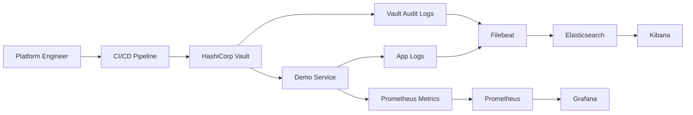

# Secure Secrets Management & Observability Toolkit

Secure secrets management and observability toolkit for platform teams that need automated secrets rotation and compliance-ready telemetry on Kubernetes.

## Features
- HashiCorp Vault with AppRole auth, policies, and audit logs
- Demo service that pulls secrets from Vault and exposes Prometheus metrics
- Filebeat shipping application and Vault audit logs to Elasticsearch with Kibana search
- Terraform modules for Vault policies and Helm-based observability provisioning
- CI/CD rotation workflow sample for automated credentials management
- Docker Compose stack for end-to-end local verification

## Tech stack (and why)
- HashiCorp Vault: dynamic secrets, short-lived tokens, and audit trails.
- Terraform + Helm: reusable IaC modules for policies and observability stacks.
- Docker Compose: reproducible local stack for demos and validation.
- Elasticsearch + Kibana: searchable logs and compliance-friendly audits.
- Prometheus: metrics collection for service health and rotation events.
- Grafana: dashboards for SLOs and compliance reporting.
- Node.js: lightweight demo service with Vault integration and metrics.
- CI/CD: rotation automation hooks.

## Demo
- Live: local demonstration; use the commands below.
- Screenshots:
  - `screenshots/20251228_1751_Secrets Management Toolkit_simple_compose_01kdjtf1f8fw6br0mfmzqtw691.png`
  - `screenshots/20251228_1751_Secrets Management Toolkit_simple_compose_01kdjtf1fafb2857jeew5kqwcv.png`
  - `screenshots/20251228_1751_Secrets Management Toolkit_simple_compose_01kdjtf1fbfkjvfczj5sfnsb8z.png`
  - `screenshots/20251228_1751_Secrets Management Toolkit_simple_compose_01kdjtf1fcew3v42xfqes7yk3a.png`


## Quickstart (local)
Prereqs:
- Docker and Docker Compose
- Make (optional)

Run:
```
make dev
# or: docker compose up --build
```

Verify:
```
curl http://localhost:8080/health
curl http://localhost:8080/secret
```

Rotate a secret:
```
make rotate-secret
```

Open dashboards:
- Vault: http://localhost:8200 (token: dev-root-token)
- Kibana: http://localhost:5601
- Prometheus: http://localhost:9090
- Grafana: http://localhost:3000 (admin / admin)

What to expect:
- `/secret` returns masked values fetched from Vault.
- Kibana shows Filebeat logs (index pattern: `filebeat-*`).
- Grafana dashboards show secret refresh and request metrics.

Kibana note: create an index pattern `filebeat-*` to view logs from the demo app and Vault audit stream.

Terraform (optional):
```
cd terraform/examples/local-vault
export VAULT_TOKEN=dev-root-token
terraform init
terraform apply -var="vault_token=${VAULT_TOKEN}"
```

## Architecture


Vault brokers secrets for workloads via AppRole and audit logging. The demo service fetches secrets on a schedule, emits metrics, and logs access events. Filebeat forwards app logs and Vault audit logs to Elasticsearch, while Prometheus and Grafana surface health and rotation visibility.

## Tests
```
make test
```

## Security
Secrets: use `.env` (see `.env.example`). Vault runs in dev mode for local demos, and Elasticsearch/Kibana security is disabled for simplicity. In production, enable TLS, RBAC, network policies, and authentication for Elastic and Grafana, and use auto-unseal with KMS.

## Notes / limitations
- Status: MVP; local stack runs in dev mode for fast demos.

## Roadmap / tradeoffs
- OPA/Conftest checks Vault application capabilities, Terraform/HCL and Kubernetes manifests with `make policy` and required root CI; see [policy coverage](../policies/README.md).
- Grafana provisions overdue-rotation and failed-fetch rules, with firing/resolved notifications in the local /alerts inbox and a [recovery runbook](runbooks/failed-rotation.md).
- The [KMS/region demonstration](#kms-and-region-demonstration) uses Vault Transit as a local KMS and two independent file-backed Vault regions, with guarded KV replication and failover.
- Tradeoff: running Vault plus Elastic and Prometheus adds operational overhead in exchange for compliance and visibility.

## Skills and Deliverables
- Kubernetes
- HashiCorp Vault
- Terraform
- Prometheus
- Grafana

Role: AI Platform Engineer.

### Vault container compatibility checks

`make test` runs the Node tests and an isolated Vault/AppRole integration
probe. The probe creates a unique Compose project, publishes no ports, checks the
application can read its secret and verifies the audit file, then removes only its
temporary containers and volumes.

Vault uses its image-owned `/vault/logs` directory for the audit volume and
`/vault/file` for the bootstrap output. The application and Filebeat keep their
existing read-only mounts of those named volumes. Back up retained volumes and
verify their ownership before migrating an existing installation; the tests use
new volumes and do not change existing data or permissions.

## Isolated functional demonstration

From the repository root:

```bash
python scripts/demo-check.py secrets
# Retain a successful stack for inspection:
python scripts/demo-check.py secrets --keep
```

The verifier uses fresh data and random loopback ports, prints the exact URLs and
cleanup command, and fails if the demonstrated behavior is missing. The check waits for the real secret refresh interval and verifies both application and Vault audit events in Elasticsearch. Secrets are masked in application responses.

## KMS and region demonstration

Run from this project with Python 3.11+ and Docker:

```bash
python scripts/kms-region-demo.py
```

The verifier creates three isolated, file-backed Vault servers: a Transit KMS and
two application regions. It checks automatic unsealing after restart, KMS key
rotation, two secret versions replicated with SHA-256 readback, rejection of a
stale compare-and-set write, and read failover to the secondary region. It then
stops the KMS, restarts the secondary Vault, requires evidence of a KMS connection
failure with no usable secret endpoint, restores the KMS and checks the retained
data. The native Vault client timeout is explicitly three seconds in this local
test so an unavailable KMS produces a bounded failure.

Credentials exist only in the test process and private container environments;
the output contains status, versions and content digests. The test removes its
own containers and volumes in a `finally` block. It uses random loopback ports and
does not need cloud accounts. This demonstrates application-level KV replication
and a local Transit KMS, not Vault Enterprise DR or a cloud provider's KMS service.
See the [Vault Transit seal documentation](https://developer.hashicorp.com/vault/docs/configuration/seal/transit).

The main application refuses expired cached secrets, returns degraded health after
a failed refresh, and recovers after Vault becomes available. Provisioned Grafana
rules send firing and resolved events to the local `/alerts` inbox for failed
refreshes and overdue rotation. The complete demo checks these transitions; it
does not send email or contact external paging services.

## Verified screenshots

See the [per-function screenshot index](screenshots/README.md) for the existing local demonstration flows and their verification scope.
